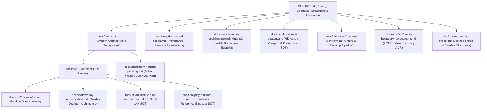

# Documentation Architecture & Reference Index

Welcome to the `aoe2-ps2-recomp` documentation tree. This repository adheres to a strict documentation hierarchy where all documents link into a coherent chain leading directly to [`CLAUDE.md`](../CLAUDE.md) (and its symlinks `AGENTS.md` and `GEMINI.md`).

---

## 1. Top-Level Index & Document Hierarchy

---

## 2. Directory Structure & Key Documents

### Core Architectural Documents (Directly Linked in `CLAUDE.md`)
1. **[`CLAUDE.md`](../CLAUDE.md)**: The root instructions, build commands, layer boundaries, and non-negotiable legal/provenance invariants.
2. **[`docs/architecture.md`](architecture.md)**: Deep architectural overview of the Emotion Engine (R5900, VU0/VU1, GS, IOP), layer isolation, and runtime design.
3. **[`docs/switch-target-architecture.md`](switch-target-architecture.md)**: The definitive blueprint for the Nintendo Switch target (Horizon OS services, `appletHook` 720p/1080p scaling, `audren` audio, Title Takeover memory protection, and touch/Joy-Con input).
4. **[`docs/sot/hd-assets-strategy.md`](sot/hd-assets-strategy.md)**: Canonical Source of Truth for HD Edition 2013 assets, runtime playfield rasterization realities, and the viewport expansion strategy.
5. **[`docs/adr/0001-kcet-boundary-replacement.md`](adr/0001-kcet-boundary-replacement.md)**: Architectural Decision Record governing the runtime replacement of the game's KCET hardware abstraction layer.
6. **[`docs/sot/prior-art-and-reuse.md`](sot/prior-art-and-reuse.md)**: Provenance, license compatibility, third-party dependency rules, and authorized decompilation reuse permissions.
7. **[`docs/desktop-runtime-probe.md`](desktop-runtime-probe.md)**: Desktop Linux bring-up probe results, runtime initialization, and dynamic overlay milestones.
8. **[`docs/ghidra-ps2recomp-workflow.md`](ghidra-ps2recomp-workflow.md)**: Headless Ghidra export, TOML configuration, and PS2Recomp codegen pipeline.
9. **[`docs/multiplatform-build-isolation.md`](multiplatform-build-isolation.md)**: Multi-platform build artifact isolation and target switching strategy (Desktop, Nintendo Switch, Android).

---

### Sources of Truth (`docs/sot/`)
Subsystem-specific behavioral specifications:
* **[`docs/sot/overlay-recompilation.md`](sot/overlay-recompilation.md)**: Multi-menu, lobby, and scenario dynamic overlay recompilation and dispatch.
* **[`docs/sot/multiplayer-lan-architecture.md`](sot/multiplayer-lan-architecture.md)**: i.LINK / UDP network emulation and discovery.
* **[`docs/sot/play-emulator-sot.md`](sot/play-emulator-sot.md)**: Play! emulator hardware reference behavior for SIF/IOP handshakes.
* **Subsystem Semantics**:
  - `gpu-semantics.md`: GS drawing and texture uploads.
  - `file-cdvd-semantics.md`: CDVD streaming, sector reads, and file tables.
  - `pad-libpad-semantics.md` & `input-modules-semantics.md`: Controller polling and DualShock 2 registers.
  - `mc-semantics.md`: Memory card storage and save serialization.
  - `hd-semantics.md`: Virtual hard drive and host storage model.

---

### Plans & Work in Progress (`docs/plans/`)
* **[`docs/plans/nifty-herding-pudding.md`](plans/nifty-herding-pudding.md)**: **Active implementation plan** for Phase A–D (configurable engine viewport, 1:1 playfield presentation, and border-anchored HUD recomposition).

---

## 3. Maintenance & Linking Rules

- Every new document created in `docs/` must link back to either [`docs/README.md`](README.md) or [`CLAUDE.md`](../CLAUDE.md).
- Do not create orphaned plans or specifications. When a phase is completed, consolidate its findings into the appropriate `docs/sot/` document and update the index.
