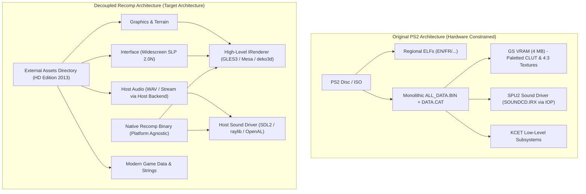

# Asset Decoupling Architecture: HD Edition Assets as Primary Target

This document establishes the architectural requirement and directory layout for **decoupling game assets from the core recompilation binary** across all target platforms (Desktop Linux/Windows, Nintendo Switch, and future ports).

The ultimate goal of this project is to use **Age of Empires II (HD Edition / 2013)** assets as the primary presentation layer, completely bypassing the legacy PS2 hardware-constrained mechanics (SPU2 audio drivers, 4-bit/8-bit GS paletted textures, 640x480 fixed 4:3 UI layouts, and PS2-specific localized strings/binaries).

---

## 1. Core Principles

1. **Clean Separation of Code and Content**:
   - The compiled static recompilation binary (`aoe2_recomp` / NRO / executable) must contain only guest execution logic, runtime layers, and engine orchestration.
   - Assets are **never bundled, embedded, or linked directly** into the main executable binary.

2. **Bypassing PS2-Specific Legacy Systems**:
   - **Graphics & Textures**: Avoid low-level GS (Graphics Synthesizer) paletted texture emulation and CLUT swapping. Assets are loaded directly from the loose HD dataset (SLP 2.0N / RGBA atlases) and rendered via modern graphics APIs (`aoe2::renderer::IRenderer` via OpenGL ES 3 / Mesa).
   - **User Interface & Layouts**: Abandon fixed 4:3 640x480 PS2 UI assets. Use modern widescreen and multi-resolution frames (`50100` and variants) from HD Edition.
   - **Audio & SPU2**: Avoid emulating PS2 IOP audio modules (`SOUNDCD.IRX`, `LIBSD.IRX`, `SDRDRV.IRX`). Sound effects (WAV) and streaming music are fed directly into a modern host audio backend (SDL2 / raylib / OpenAL).
   - **Localization & Strings**: Decouple text strings from PS2 regional disc partitions (`EN/`, `FR/`, `GR/`, `IT/`, `SP/`).

3. **Multiplatform Parity**:
   - Every supported platform (Desktop, Switch homebrew, Android) must use a standardized, mirror-matched directory structure for locating and loading external assets.

---

## 2. Target Platform Asset Layout

On all platforms, the runtime resolves an external **Assets Directory** located relative to the executable or the platform data root.

### Standardized Layout:

```
<App_or_Game_Root>/
├── aoe2_recomp[.elf|.nro|.exe]    # Recompiled binary (stateless code & logic)
└── assets/                        # Decoupled HD asset tree
    ├── interface/                 # Widescreen HUD, menus, frames, fonts (SLP 2.0N / loose)
    ├── graphics/                  # Units, buildings, projectiles (SLP 2.0N / loose)
    ├── terrain/                   # Textures, blending tiles, water (loose / mipmapped)
    ├── sound/                     # Clean PCM WAV effects (bypassing SPU2/IRX)
    ├── music/                     # High-fidelity music streams (MP3/OGG/FLAC)
    ├── gamedata/                  # empires2_x1_p1.dat (tech tree, combat stats)
    └── strings/                   # Decoupled key-value string localization
```

### Platform Specific Mount Points:

| Platform | Executable Location | Assets Root Path | Notes |
| :--- | :--- | :--- | :--- |
| **Desktop (Linux/x86_64)** | `build/aoe2_recomp` | `./assets/` or `~/.local/share/aoe2-recomp/assets/` | Relative to working directory or XDG data home |
| **Desktop (Windows)** | `aoe2_recomp.exe` | `./assets/` or `%APPDATA%/aoe2-recomp/assets/` | Relative to `.exe` |
| **Nintendo Switch (libnx)** | `sdmc:/switch/aoe2/aoe2.nro` | `sdmc:/switch/aoe2/assets/` or `romfs:/assets/` | External on SD card or mounted via RomFS |
| **Android (NDK)** | APK internal native lib | External files dir: `Android/data/<pkg>/files/assets/` | Readily swappable without recompiling APK |

---

## 3. Comparison: Original PS2 vs Recomp HD Decoupled



| Subsystem | Original PS2 Architecture | New Decoupled HD Target |
| :--- | :--- | :--- |
| **Containerization** | Packed inside `ALL_DATA.BIN` indexed by `DATA.CAT`. | Loose files indexed by numeric ID in category directories (`interface/`, `graphics/`, etc.). |
| **Palettes & Color** | 8-bit indexed textures with dynamic 256-color CLUTs loaded in GS local memory. | Truecolor 32-bit RGBA or pre-baked SLP 2.0N loaded directly to host GPU textures. |
| **Aspect Ratio & HUD** | Hardcoded 4:3 coordinate grids (640x480). | Anchored widescreen layouts (720p handheld / 1080p docked) using HD anchor assets. |
| **Audio Processing** | 24-channel hardware ADPCM synth via IOP driver and SPU2 RAM. | Native PCM streaming and host sound mixing at 44.1/48 kHz. |
| **Local Overlays** | Overlays streamed into EE RAM from disc (`SMENU_CD.BIN`, `LOBBY_CD.BIN`). | Dynamic state machine in C++ using external asset resources. |

---

## 4. Migration Strategy

1. **Phase 1 (Completed)**:
   - Tooling implemented to import, sniff formats, verify digests, and inventory loose HD assets (`tools/import_hd_assets.py`, `tools/verify_hd_assets.py`, `tools/inventory_hd_assets.py`).
2. **Phase 2 (Current Focus)**:
   - Abstract Asset Provider interface (`aoe2::assets::IAssetProvider`) to load assets by numeric ID from the platform's external assets folder.
   - Decouple KCET rendering calls (`kt_gpu`) to redirect high-level sprite draws to modern textures rather than decoding GS VRAM packets.
3. **Phase 3**:
   - Host audio provider bypassing IOP RPC commands.
   - Widescreen coordinate translation mapping host touches/clicks directly to game simulation space while anchoring HUD elements to widescreen borders.
