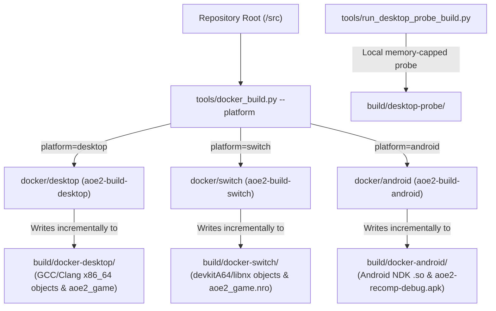

# Multi-Platform Build Artifact Isolation & Target Switching Strategy

## 1. Overview and Problem Statement

Compiling the native static-recompilation port of *Age of Empires II: The Age of Kings* (`SLES-50282`) involves compiling ~17,000 to ~58,000 generated C++ units produced by the PS2Recomp pipeline, along with the core interfaces, host layers, and runtime libraries.

Because the project targets multiple distinct environments—**Desktop Linux (x86_64)**, **Nintendo Switch (ARM64 / Horizon OS)**, and **Android (arm64-v8a / x86_64)**—each target requires its own distinct toolchain, compiler flags, sysroot, and binary ABI. Switching between targets must **never** wipe or overwrite another target's compiled object files (`.o`), intermediate CMake/Ninja caches, or final binaries.

This document describes how the codebase guarantees zero artifact collisions and enables instantaneous target switching without full rebuilds.

---

## 2. Directory Separation Architecture

All build outputs and artifacts are quarantined under dedicated, git-ignored subdirectories within `build/` (or platform-specific subtrees). The build orchestrator ([`tools/docker_build.py`](../tools/docker_build.py)) and host probe script ([`tools/run_desktop_probe_build.py`](../tools/run_desktop_probe_build.py)) enforce strict output path isolation:

| Platform / Target | Build Environment | Output Directory | Primary Artifacts |
| :--- | :--- | :--- | :--- |
| **Desktop (Release)** | Docker (`aoe2-build-desktop`) | `build/docker-desktop/` | `aoe2_game`, `desktop_runtime_probe`, `aoe2_input_tests` |
| **Desktop (Diagnostics)** | Docker (`aoe2-build-desktop`) | `build/docker-desktop-diagnostics/` | `aoe2_game` (with `-DAOE2_RUNTIME_DIAGNOSTICS=ON`) |
| **Desktop Probe (Host)** | Local host systemd scope | `build/desktop-probe/` | `desktop_runtime_probe` (headless initialization check) |
| **Nintendo Switch** | Docker (`aoe2-build-switch`) | `build/docker-switch/` | `aoe2_game_nro` (`aoe2_game.nro`), devkitA64 object cache |
| **Android** | Docker (`aoe2-build-android`) | `build/docker-android/` & `platform/android/build/` | `build/docker-android/aoe2-recomp-debug.apk` |
| **Host Scaffolding / Tests** | Local host developer shell | `build/` (or user-defined `build/local/`) | `aoe2_smoke_test`, `aoe2_input_tests` |



---

## 3. Toolchain & Container Isolation

Different platforms require mutually incompatible toolchains and sysroots:
- **Nintendo Switch** requires `Switch.cmake` and the `devkitA64` cross-toolchain provided by devkitPro. By repository policy, devkitPro is never installed directly on the host OS; it lives exclusively within `docker/switch/Dockerfile`.
- **Android** requires the Android NDK, CMake toolchain (`android.toolchain.cmake`), and the Gradle build daemon. Gradle caches and builds are isolated under `build/docker-android/gradle-home` and `platform/android/build`.
- **Desktop** uses host/container GNU/Clang compilers and Mesa OpenGL / X11 development headers.

Because each Docker container runs with `-B {build_dir}` pointing to its dedicated path, CMake configuration caches (`CMakeCache.txt`), compiler response files, and Ninja build manifests (`build.ninja`) are never mixed.

---

## 4. Concurrent Execution & Container Identification

All containerized build and test drivers enforce unique, non-colliding container names, hostnames, and metadata labels. Builds and tests for different platforms (`desktop` / `pc`, `android`, `switch`) can run concurrently without collision:

| Role | Platform / Target | Container Name | Hostname | Labels | Default Jobs |
| :--- | :--- | :--- | :--- | :--- | :--- |
| **Build** | Desktop (Release) | `aoe2-build-desktop` | `aoe2-build-desktop` | `aoe2.platform=desktop`, `aoe2.role=build` | `-j8` |
| **Build** | Desktop (Diagnostics) | `aoe2-build-desktop-diagnostics` | `aoe2-build-desktop-diagnostics` | `aoe2.platform=desktop`, `aoe2.role=build` | `-j8` |
| **Build** | Nintendo Switch | `aoe2-build-switch` | `aoe2-build-switch` | `aoe2.platform=switch`, `aoe2.role=build` | `-j8` |
| **Build** | Android | `aoe2-build-android` | `aoe2-build-android` | `aoe2.platform=android`, `aoe2.role=build` | `-j8` |
| **Test** | Desktop Validation | `aoe2-validate-desktop` | `aoe2-validate-desktop` | `aoe2.platform=desktop`, `aoe2.role=validate` | `-j8` |
| **Test** | Switch Validation | `aoe2-validate-switch` | `aoe2-validate-switch` | `aoe2.platform=switch`, `aoe2.role=validate` | `-j8` |
| **View** | Switch noVNC View | `aoe2-view-switch` | `aoe2-view-switch` | `aoe2.platform=switch`, `aoe2.role=view` | `-j8` |
| **Test** | Android Validation | `aoe2-validate-android` | `aoe2-validate-android` | `aoe2.platform=android`, `aoe2.role=validate` | `-j8` |

### Concurrency & Cache Guarantees:
1. **Container Name Isolation**: Running `docker_build.py --platform desktop`, `docker_build.py --platform android`, and `docker_build.py --platform switch` simultaneously spins up containers with completely distinct IDs (`aoe2-build-desktop`, `aoe2-build-android`, `aoe2-build-switch`), avoiding Docker daemon name conflicts.
2. **Build Cache Preservation**:
   - Desktop and Switch preserve intermediate CMake/Ninja `.o` and `.ninja_deps` files under `build/docker-desktop/` and `build/docker-switch/`.
   - Android utilizes Gradle's `--build-cache` and isolates Gradle home cache in `build/docker-android/gradle-home` and native C++ in `build/android-cxx`.
   - HD asset staging acquires an exclusive file lock (`.staging.lock`) during preparation so concurrent builds never corrupt staged assets or manifests.
3. **Default Parallelism**: All containerized commands default to `-j8` / `--cpus=8`.
4. **Platform Aliases**: `--platform pc` is supported as an alias for `--platform desktop`.

---

## 5. Switching Targets Incrementally

When switching targets, Ninja and Gradle inspect timestamps in their respective isolated build directories. Generated PS2Recomp files under `generated/SLES-50282/` are read-only inputs mounted into the containers:

1. **Compiling Switch after Desktop**:
   ```bash
   python3 tools/docker_build.py --platform switch --jobs 8
   ```
   *Reads* the generated sources and writes objects to `build/docker-switch/`. `build/docker-desktop/` remains untouched.

2. **Switching back to Desktop**:
   ```bash
   python3 tools/docker_build.py --platform desktop --jobs 8
   ```
   Ninja immediately inspects `build/docker-desktop/build.ninja`. If no source or header files were changed, it exits with `ninja: no work to do`. If only a few host-layer files (e.g., `game_hooks/` or `input/`) changed, **only those specific files are recompiled**. The thousands of unchanged generated game logic files are **not recompiled**.

3. **Building Android APK**:
   ```bash
   python3 tools/docker_build.py --platform android --jobs 8
   ```
   Gradle compiles native C++ libraries for `arm64-v8a` and `x86_64` using `platform/android/build.gradle`, producing `build/docker-android/aoe2-recomp-debug.apk`.

---

## 6. Local Host Development Best Practices

- **Never configure CMake directly at the repo root with default `build/` for full game targets**:
  Running `cmake -B build` is reserved for lightweight host interface tests (`aoe2_interfaces`, `aoe2_smoke_test`).
- **Use the dedicated tool wrappers**:
  Always invoke `python3 tools/docker_build.py --platform <desktop|pc|switch|android>` or `python3 tools/run_desktop_probe_build.py` to prevent memory exhaustion and preserve directory isolation.
