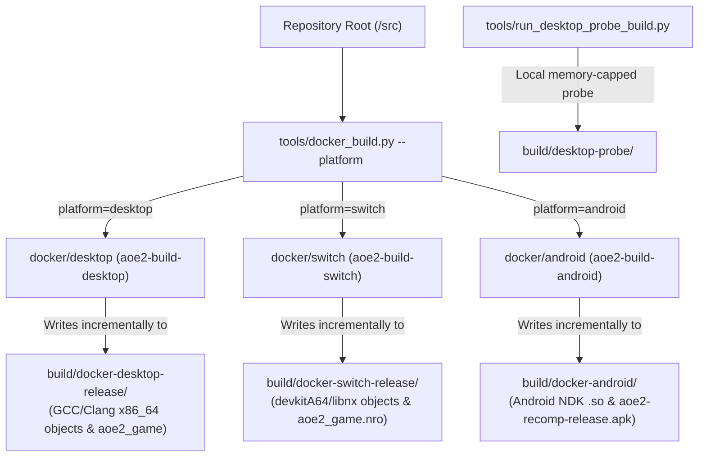

# Multi-Platform Build Artifact Isolation & Target Switching Strategy

## 1. Overview and Problem Statement

Compiling the native static-recompilation port of *Age of Empires II: The Age of Kings* (`SLES-50282`) involves compiling ~17,000 to ~58,000 generated C++ units produced by the PS2Recomp pipeline, along with the core interfaces, host layers, and runtime libraries.

Because the project targets multiple distinct environments—**Desktop Linux (x86_64)**, **Nintendo Switch (ARM64 / Horizon OS)**, and **Android (arm64-v8a / x86_64)**—each target requires its own distinct toolchain, compiler flags, sysroot, and binary ABI. Switching between targets must **never** wipe or overwrite another target's compiled object files (`.o`), intermediate CMake/Ninja caches, or final binaries.

This document describes how the codebase guarantees zero artifact collisions and enables instantaneous target switching without full rebuilds.

---

## 2. Directory Separation Architecture

All build outputs and artifacts are quarantined under dedicated, git-ignored subdirectories within `build/` (or platform-specific subtrees). The build orchestrator ([`tools/docker_build.py`](../tools/docker_build.py)) and host probe script ([`tools/run_desktop_probe_build.py`](../tools/run_desktop_probe_build.py)) enforce strict output path isolation:

| Platform / Target | Build Environment | Output Directory | Primary Artifacts |
| :--- | :--- | :--- | :--- |
| **Desktop (Debug)** | Docker (`aoe2-build-desktop`) | `build/docker-desktop/` | `aoe2_game`, `desktop_runtime_probe`, `aoe2_input_tests` |
| **Desktop (Diagnostics)** | Docker (`aoe2-build-desktop`) | `build/docker-desktop-diagnostics/` | `aoe2_game` (with `-DAOE2_RUNTIME_DIAGNOSTICS=ON`) |
| **Desktop (Release / RelWithDebInfo)** | Docker (type-specific name) | `build/docker-desktop-release/`, `build/docker-desktop-relwithdebinfo/` | `aoe2_game` |
| **Desktop Probe (Host)** | Local host systemd scope | `build/desktop-probe/` | `desktop_runtime_probe` (headless initialization check) |
| **Nintendo Switch** | Docker (`aoe2-build-switch`) | `build/docker-switch/` | `aoe2_game_nro` (`aoe2_game.nro`), devkitA64 object cache |
| **Nintendo Switch (Release / RelWithDebInfo)** | Docker (type-specific name) | `build/docker-switch-release/`, `build/docker-switch-relwithdebinfo/` | `aoe2_game.nro` |
| **Android (Debug)** | Docker (`aoe2-build-android`) | `build/docker-android/` & `build/android-cxx/debug` | `build/docker-android/aoe2-recomp-debug.apk` |
| **Android (Release)** | Docker (`aoe2-build-android-release`) | `build/docker-android-release/` & `build/android-cxx/release` | `build/docker-android-release/aoe2-recomp-release.apk` |
| **Host Scaffolding / Tests** | Local host developer shell | `build/` (or user-defined `build/local/`) | `aoe2_smoke_test`, `aoe2_input_tests` |



---

## 3. Toolchain & Container Isolation

Different platforms require mutually incompatible toolchains and sysroots:
- **Nintendo Switch** requires `Switch.cmake` and the `devkitA64` cross-toolchain provided by devkitPro. By repository policy, devkitPro is never installed directly on the host OS; it lives exclusively within `docker/switch/Dockerfile`.
- **Android** requires the Android NDK, CMake toolchain (`android.toolchain.cmake`), and the Gradle build daemon. Gradle caches and builds are isolated per build type under `build/docker-android[-<type>]/gradle-home` and `build/android-cxx[-<type>]`.
- **Desktop** uses host/container GNU/Clang compilers and Mesa OpenGL / X11 development headers.

Because each Docker container runs with `-B {build_dir}` pointing to its dedicated path, CMake configuration caches (`CMakeCache.txt`), compiler response files, and Ninja build manifests (`build.ninja`) are never mixed.

---

## 4. Concurrent Execution & Container Identification

All containerized build and test drivers enforce unique, non-colliding container names, hostnames, and metadata labels. Builds and tests for different platforms (`desktop` / `pc`, `android`, `switch`) can run concurrently without collision:

| Role | Platform / Target | Container Name | Hostname | Labels | Default Jobs |
| :--- | :--- | :--- | :--- | :--- | :--- |
| **Build** | Desktop (Debug) | `aoe2-build-desktop` | `aoe2-build-desktop` | `aoe2.platform=desktop`, `aoe2.role=build` | `-j8` |
| **Build** | Desktop (Diagnostics) | `aoe2-build-desktop-diagnostics` | `aoe2-build-desktop-diagnostics` | `aoe2.platform=desktop`, `aoe2.role=build` | `-j8` |
| **Build** | Nintendo Switch | `aoe2-build-switch` | `aoe2-build-switch` | `aoe2.platform=switch`, `aoe2.role=build` | `-j8` |
| **Build** | Android | `aoe2-build-android` | `aoe2-build-android` | `aoe2.platform=android`, `aoe2.role=build` | `-j8` |
| **Test** | Desktop Validation | `aoe2-validate-desktop` | `aoe2-validate-desktop` | `aoe2.platform=desktop`, `aoe2.role=validate` | `-j8` |
| **Test** | Switch Validation | `aoe2-validate-switch` | `aoe2-validate-switch` | `aoe2.platform=switch`, `aoe2.role=validate` | `-j8` |
| **View** | Switch noVNC View | `aoe2-view-switch` | `aoe2-view-switch` | `aoe2.platform=switch`, `aoe2.role=view` | `-j8` |
| **Test** | Android Validation | `aoe2-validate-android` | `aoe2-validate-android` | `aoe2.platform=android`, `aoe2.role=validate` | `-j8` |

### Concurrency & Cache Guarantees:
1. **Container Name Isolation**: Running `docker_build.py --platform desktop`, `docker_build.py --platform android`, and `docker_build.py --platform switch` simultaneously spins up distinct Release containers (`aoe2-build-desktop-release`, `aoe2-build-android-release`, `aoe2-build-switch-release`), avoiding Docker daemon name conflicts.
2. **Build Cache Preservation**:
   - Desktop and Switch preserve intermediate CMake/Ninja `.o` and `.ninja_deps` files under `build/docker-desktop[-<type>]/` and `build/docker-switch[-<type>]/`.
   - Android utilizes Gradle's `--build-cache` and isolates Gradle home cache in `build/docker-android[-<type>]/gradle-home` and native C++ in `build/android-cxx[-<type>]`.
   - HD asset staging acquires an exclusive file lock (`.staging.lock`) during preparation so concurrent builds never corrupt staged assets or manifests.
3. **Default Parallelism**: All containerized commands default to `-j8` / `--cpus=8`.
4. **Platform Aliases**: `--platform pc` is supported as an alias for `--platform desktop`.

---

## 5. Screenshot & Visual Evidence Isolation

In accordance with repository guidelines (`Screenshots only in .playwright-mcp`), all visual evidence captured during automated or interactive test runs is strictly segregated into platform-specific subdirectories under `.playwright-mcp/`:

| Platform / Edition | Screenshot Directory | Artifacts Captured | Driver Script |
| :--- | :--- | :--- | :--- |
| **Desktop / PC** | `.playwright-mcp/pc/` | `desktop-validation-*.png`, `campaign-*.png`, scenario traces | `tools/validate_desktop.py`, `tools/drive_desktop_scenario.py` |
| **Nintendo Switch** | `.playwright-mcp/switch/` | `screen-*.png`, Ryujinx headless captures, noVNC evidence | `tools/validate_switch.py`, `tools/view_switch_novnc.py` |
| **Android** | `.playwright-mcp/android/` | `screen-*.png`, adb screencap dumps | `tools/validate_android.py` |

This directory hierarchy ensures that concurrent or sequential validation runs across different target platforms never overwrite or collide with each other's visual evidence.

---

## 6. Switching Targets Incrementally

When switching targets, Ninja and Gradle inspect timestamps in their respective isolated build directories. Generated PS2Recomp files under `generated/SLES-50282/` are read-only inputs mounted into the containers:

1. **Compiling Switch after Desktop**:
   ```bash
   python3 tools/docker_build.py --platform switch --jobs 8
   ```
   *Reads* the generated sources and writes objects to `build/docker-switch-release/`. `build/docker-desktop-release/` remains untouched.

2. **Switching back to Desktop**:
   ```bash
   python3 tools/docker_build.py --platform desktop --jobs 8
   ```
   Ninja immediately inspects `build/docker-desktop-release/build.ninja`. If no source or header files were changed, it exits with `ninja: no work to do`. If only a few host-layer files (e.g., `game_hooks/` or `input/`) changed, **only those specific files are recompiled**. The thousands of unchanged generated game logic files are **not recompiled**.

3. **Building Android APK**:
   ```bash
   python3 tools/docker_build.py --platform android --jobs 8
   ```
   Gradle compiles native C++ libraries for `arm64-v8a` and `x86_64` using `platform/android/build.gradle`, producing `build/docker-android/aoe2-recomp-release.apk`.

---

## 7. Local Host Development Best Practices

- **Never configure CMake directly at the repo root with default `build/` for full game targets**:
  Running `cmake -B build` is reserved for lightweight host interface tests (`aoe2_interfaces`, `aoe2_smoke_test`).
- **Use the dedicated tool wrappers**:
  Always invoke `python3 tools/docker_build.py --platform <desktop|pc|switch|android>` or `python3 tools/run_desktop_probe_build.py` to prevent memory exhaustion and preserve directory isolation.

---

## 8. Agent Skills Integration

For autonomous agent and pair-programming workflows, dedicated skills are provided under `.agents/skills/` (and mirrored in `.claude/skills/`):
- **`docker-build`** ([`.agents/skills/docker-build/SKILL.md`](../.agents/skills/docker-build/SKILL.md)): Automated build invocation across all targets with default `-j8`, build cache preservation, diagnostics, and high-level output.
- **`docker-validate`** ([`.agents/skills/docker-validate/SKILL.md`](../.agents/skills/docker-validate/SKILL.md)): Automated runtime validation, probe execution, high-output log capture, and live noVNC inspection inside containers.

---

## 9. Build Type Selection & Output Policy

Release is the default for regular builds. Desktop and Switch also accept `--build-type Debug` or `--build-type RelWithDebInfo`; each type has a dedicated directory and container name, so a change of configuration cannot reuse incompatible objects. Runtime diagnostics are opt-in. Android supports Debug and Release Gradle variants; the Release APK uses the local debug signing key and is not distribution-signed. Desktop `--diagnostics` defaults to Debug. Existing validation tools that require Debug artifacts still use their explicitly documented paths.

### 1. Rationale
Recompiling ~17,000 to ~58,000 guest functions alongside native KCET shims requires maximum transparency:
- **Fast Failure & Stack Traces**: Release builds optimize away call stacks, inline crucial boundaries, and strip assertions (`NDEBUG`), hiding silent memory corruptions and infinite loops. Debug builds preserve line-level symbol resolution and halt at the exact site of failure.
- **Missing Function Trapping**: In diagnostic builds (`-DAOE2_RUNTIME_DIAGNOSTICS=ON`), unmapped guest branches trigger `[guest-branch:missing-target]` and halt immediately via `StopOnMissingFunction`, preventing silent spin-locks.
- **RPC & Protocol Observability**: Aggressive logging exposes every SIF/IOP RPC transaction, DECI2 packet, and DMA buffer exchange.

### 2. Configuration Matrix by Platform

| Target | Build Configuration | Verbosity & Output Flags | Artifacts / Logs |
| :--- | :--- | :--- | :--- |
| **Desktop / PC** | `Release` (default), `Debug`, or `RelWithDebInfo`; `--diagnostics` is explicit | `cmake --build ... -v`<br/>`ctest --output-on-failure -V` | `build/docker-desktop[-<type>[-diagnostics]]/` |
| **Nintendo Switch**| `Release` (default), `Debug`, or `RelWithDebInfo` | `cmake --build ... -v`; runtime diagnostics off by default | `build/docker-switch[-<type>]/` |
| **Android** | `assembleRelease` (default) or `assembleDebug` | Gradle variant-specific native configuration | `build/docker-android/aoe2-recomp-{release,debug}.apk` |

HD asset staging and loader initialization are compile-time opt-ins, disabled by default. Pass `--enable-hd-assets` to stage the local catalog and configure `AOE2_ENABLE_HD_ASSETS=ON`; a normal build does not inspect or load the optional HD asset tree.

Example optimized Switch build:

```bash
python3 tools/docker_build.py --platform switch --build-type Release --jobs 8
# build/docker-switch-release/aoe2_game.nro
```

### 3. High-Output Runtime Environment Variables
When investigating runtime behavior, opt in to the relevant trace logging; it can reduce performance:
- `AOE2_CALL_TRACE_FIRST=N`: Sets how many initial calls per guest function are logged to stderr (default 3).
- `AOE2_CALL_TRACE_MEM=1`: Prints a 16-byte hex memory dump of the block pointed to by register `$a0`.
- `AOE2_SHAPE_TRACE=1`: Reports every SLP shape load and frame rasterization call.
- `AOE2_GAME_TTY=ON`: Captures EE kernel `printf` via DECI2 `[game-tty]`.

## Disc extraction and dist folders

`tools/docker_build.py` runs `tools/extract_disc.py` first (skip with `--skip-extract`): it
extracts the ISO into `game/SLES-50282/` with a `disc_layout.json` manifest of real LBNs. The
runtime registers those files at their true sectors, so devices need no ISO. `tools/setup_game.py`
stages `dist/<device>/` (git-ignored) without any `.iso`; the Switch and Android validators also
skip `aoe2.iso` when seeding the device.

### Validation build selection

Desktop and Switch validators select the standard Release artifacts by default. Use
`--build-type debug` for the standard Debug artifacts; game startup, scenario waits
and explicit `--run-seconds` use a 10× Debug budget. Screenshot intervals and
input durations do not scale. The Switch defaults to GS and the smoke scenario.
Campaign results require visual inspection; a log marker alone does not establish
that the map is visible. The current Release artifacts do not emit the guest tick
evidence required by the classifier, so a Release validation cannot yet pass until
validation telemetry is implemented in the shared runtime.
