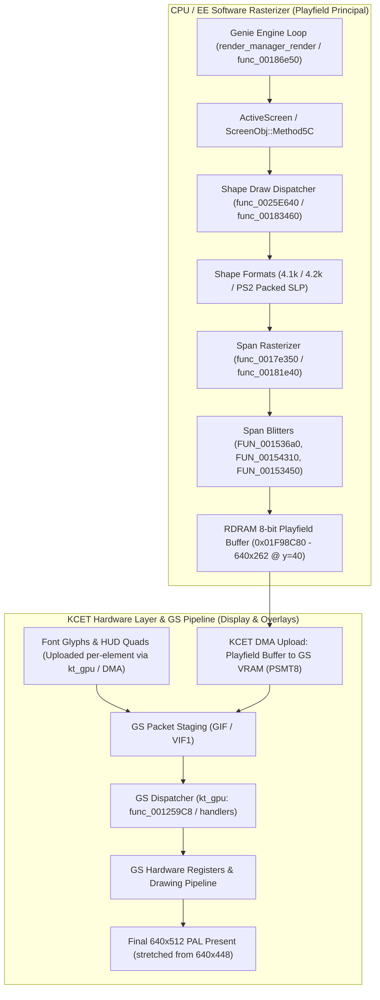

# Cadeia Real de Renderização vs. Comandos GS no Age of Empires II (PS2)

Este documento descreve o caminho original e hipóteses de investigação. O [contrato canônico sem GS](high-level-draw-seams.md#7-gs-independent-presentation-contract) e o [roteiro de implementação](../plans/gs-independent-rendering.md) prevalecem quanto ao estado atual, às dependências e à aceitação.

## 1. Sumário Executivo

A investigação detalhada do código recompilado, da base descompilada (`third_party/age-of-empires-2-decomp`) e das medições em tempo de execução revela uma verdade fundamental:

> [!IMPORTANT]
> **O jogo NÃO usa comandos do GS para desenhar sprites individuais, unidades ou terreno.**
> No Age of Empires II de PS2, o playfield (mapa isométrico, unidades, prédios, terreno e névoa de guerra) é inteiramente rasterizado **em software na CPU (EE/RDRAM)** em um buffer indexado de 8 bits (640×262). O GS recebe apenas a imagem final desse buffer já montado via DMA GIF (`IMAGE` transfer) e alguns pequenos quads de UI/texto.

Portanto, tentar transformar chamadas do `kt_gpu` em chamadas de alto nível do `aoe2::renderer::IRenderer` como se o GS recebesse "DrawUnit" ou "DrawSprite" é um equívoco conceitual. No nível do `kt_gpu`/GS, a identidade semântica de unidades e terreno já foi completamente perdida (são apenas pixels brutos em um buffer linear).

A verdadeira interceptação de alto nível para renderização nativa (HD sprites, expansão de viewport) reside nas rotinas de desenho de shape da Genie Engine (`func_0025E640` / `func_00183460`) ou no span rasterizer (`func_0017e350`).

---

## 2. A Arquitetura Híbrida de Renderização do PS2

O pipeline visual do jogo divide-se estritamente em dois subsistemas:

---

## 3. O Caminho Real de Desenho em Software (Passo a Passo)

### Passo 1: Loop de Renderização do Frame
- **Ponto de entrada:** `RenderManagerRender::func_00186e50` (`src/render/render_manager_render.cpp`).
- Executa a cada tick gráfico da engine. Obtém o `ActiveScreen` via `func_1F26C0((void*)D_00A80BB0)`.
- Invoca `screen->Method5C()`, que desencadeia a travessia das entidades espaciais, terreno e visibilidade da zona ativa.

### Passo 2: Seleção e Carregamento de Recursos (Shapes)
- O jogo gerencia shapes através da API interna da engine (`func_0025D6D0`, que carrega arquivos de resources como `DATA.CAT` / `ALL_DATA.BIN` cujos IDs observados incluem correspondências com IDs do PC, como `50100` e `2296`; a correspondência universal não está demonstrada.).
- Os formatos de dados na memória do PS2 são variantes compactadas:
  1. Header bruto com tabela de frames e dimensões.
  2. Containers identificados por tags ASCII `4.1k` e `4.2k`.

### Passo 3: O Despachante de Desenho de Shapes
- **Funções:** `func_0025E640` e `func_00183460` (`trade_action_stream_node_base.s`).
- Parâmetros passados na chamada de desenho:
  `DrawShape(shape_ptr, area_ptr, x, y, frame_index, flags)`
  - `x` e `y` definem a origem espacial do sprite (podem ser negativos quando clipados).
  - `frame_index` seleciona o frame de animação ou orientação da unidade/prédio.
- Esta função desce para o pipeline de geração de spans em `func_00262570` e `func_002622D0`.

### Passo 4: O Span Rasterizer da Genie Engine
- **Funções centrais:** `func_0017e350` (934 KB de código MIPS gerado) e `func_00181e40`.
- Como funciona:
  - O código decompõe o sprite em linhas e trechos horizontais (*spans*).
  - Executa o clipping contra os limites da viewport da área de visão (retângulo do playfield).
  - Processa os opcodes de desenho em `func_00181e40` através de uma jump table de 9 destinos (`0x181e90` a `0x182010`), correspondendo a:
    - Cópia direta de pixels indexados.
    - Pulos de transparência (*skip runs*).
    - Mapeamento de cor do jogador (*player color transform*).
    - Tabela de sombras e translucidez (*shadow table lookup*).
- O span rasterizer chama blitters otimizados (`FUN_001536a0`, `FUN_00154310`, `FUN_00153450`) que executam os stores finais (`WRITE8` / `sb`) na memória física.

### Passo 5: O Buffer de Destino na RDRAM
- Toda a área jogável (mapa, unidades, projéteis, prédios) é gravada diretamente na RDRAM no endereço fixo **`0x01F98C80`**.
- Dimensões do buffer: **640×262** pixels, 1 byte por pixel (paletizado, 8-bit).
- Esse buffer ocupa verticalmente a região $y=40$ até $y=302$ do framebuffer lógico de 640×448 (ficando encaixado perfeitamente entre a barra de recursos superior e o painel de comandos inferior).

---

## 4. O Papel Restrito do GS e do `kt_gpu`

### O que o `kt_gpu` realmente faz?
O módulo `kt_gpu` (`src/kcet/kt_gpu.c`, endereços `0x00125808` a `0x001259C8`) é apenas um empacotador de baixo nível de comandos DMA/GIF para os registradores de hardware do GS:
- `ktGpuSetFrame1` / `ktGpuSetFrame2`: configura registradores `FRAME_1` / `FRAME_2` (`0x4C`, `0x4D`).
- `ktGpuSetZbuf1` / `ktGpuSetZbuf2`: configura `ZBUF_1` / `ZBUF_2` (`0x4E`, `0x4F`).
- `ktGpuSetDrawRegisters`: configura registradores de teste de profundidade e controle.
- `ktGpuDispatchCommand` (`0x1259C8`): despacha pacotes através da tabela `D_38C740[kind]` para emissão GIF.

### O que transita pelo GS em cada frame?
Conforme comprovado pelas medições de runtime com `PS2X_GS_FRAME_STATS`:
1. **Upload do Playfield:** 2 transferências `IMAGE` de 640×262 (PSMT8) da RDRAM `0x01F98C80` para a VRAM do GS, desenhadas por um quad texturizado cobrindo $(0, 40) \to (640, 302)$.
2. **Glifos de Texto:** Cerca de 75 pequenos sprites por frame (tamanhos de 6×6 a 18×11) em PSMT4, enviados para uma área de staging temporária e desenhados como quads.
3. **Pedaços de HUD e Menus:** Uploads de texturas de interface (ex: painéis 40×80 ou 396×198) desenhados com tiras texturizadas.
4. **Stretching Final:** Cópia do buffer de trabalho de 640×448 esticado para 640×512 para saída PAL na tela.

---

## 5. Por Que Interceptar no GS é Inviável para Renderização Nativa

Tentar redirecionar o `kt_gpu` para um `IRenderer` moderno enfrenta as seguintes barreiras arquiteturais intransponíveis:

1. **Ausência de Semântica no GS:** No momento em que o comando chega ao `kt_gpu`, não existem mais soldados, árvores ou castelos; existe apenas um bloco retangular de 640×262 pixels já rasterizados e mesclados. Não é possível aplicar substituição de assets HD ou resolução maior aqui.
2. **Gargalo da VRAM de 4 MB do GS:** Se aumentássemos a resolução do playfield no GS tradicional, estouraríamos a memória de vídeo de 4 MB do GS da Sony e o limite de textura de 1024 px.
3. **Swizzling de CLUT:** Texturas de 4 bits e 8 bits sofrem swizzling de paleta no GS, gerando artefatos de ruído quando o pipeline de software tenta manipulá-las diretamente.

---

## 6. Pontos de investigação para apresentação nativa

A composição deve usar o apresentador existente; `IRenderer` não é atualmente o apresentador do Switch. A tabela apresenta candidatos e objetivos, não integração concluída:

| Subsistema Visual | Ponto Real de Interceptação | Ação Recomendada do Renderer |
| :--- | :--- | :--- |
| **Playfield (Mapa, Unidades, Terreno)** | **1. Bypass do Buffer:** Leitura direta do buffer de RDRAM `0x01F98C80` + paleta ativa, apresentando 1:1. **2. Expansão de Viewport (Fase A/B):** Alocar buffer estendido (ex: 1280×720) na RDRAM expandida de 64 MB e interceptar na inicialização do painel em `0x31a410`. **3. Substituição opcional:** investigar `func_0025E640` após comprovar identidade, ordem e supressão do desenho original. | Compor o snapshot RGBA no apresentador existente, sem usar dados produzidos pelo GS. |
| **HUD (Painel Inferior e Barra Superior)** | Interceptar no `HudLayout::ForExtent` e nas chamadas de desenho de interface da Genie Engine (`50100.slp`, `50102.slp`). | Ancorar barra de recursos no topo $(0, 0, W, 24)$ e painel de comando na base $(0, H - 120, W, H)$. |
| **Texto / Fontes** | Investigar despacho de strings e glifos antes do GS; `func_001890A0` é candidato. | Reproduzir glifos originais e métricas; FreeType/TTF é opção posterior. |
| **Ponteiro / Mouse** | Interceptar em `PresentationTransform` / `HudInverseMapper`. | Manter as coordenadas do mouse no espaço lógico correto mapeando toques do Switch para os painéis realocados. |

---

## 7. Conclusão

O "caminho real de desenho" do Age of Empires II no PS2 **é um motor de software puro de 1999 (Genie Engine) executando dentro da CPU MIPS EE**.
O **`kt_gpu` despacha configuração e pacotes de baixo nível**. O GS também compõe elementos de UI e texto; não é apenas um dispositivo de scanout.

A estratégia correta para o projeto de recompilação consiste em:
1. Manter o caminho GS apenas como referência durante a transição; a meta final inclui menus e boot sem processamento visual GS.
2. Capturar o playfield e sua paleta comprovada diretamente da memória, compondo-o no apresentador existente. A saída expandida ainda requer validação em missão.
3. Investigar UI, texto e sincronização antes do GS. Substituição individual de shapes é opcional e depende de identidade, recorte, ordem e supressão do desenho original comprovados.
