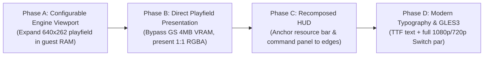

# HD Asset Strategy & Presentation Architecture (Consolidated SOT)

## 1. Executive Summary & Core Architectural Truth

This document is the **single consolidated source of truth** regarding the integration of **Age of Empires II: HD Edition (2013)** assets, presentation geometry, and rendering pipeline in `aoe2-ps2-recomp`.

It consolidates and supersedes the historical, exploratory, and fragmented documentation across:
- `docs/architecture-hd-asset-decoupling.md` (initial conceptual decoupling proposal)
- `docs/hd-assets.md` (tooling, import catalog, and staging)
- `docs/asset-merge-design.md` (truth table and implementation gap analysis)
- `docs/hd-presentation-validation.md` (presentation calibration and transform gates)
- `docs/hd-render-evidence.md` (runtime GS frame analysis and shape loader discovery)
- `docs/sot/hd-assets-resolution.md` (resolution disparity between 1999 PC, 2013 HD, and PS2)

### The Foundational Architectural Discovery
Early assumptions in this project presumed that:
1. HD Edition 2013 provided higher-resolution unit and building sprites that could be swapped in-place over the PS2's 640×448 logical framebuffer.
2. The game's presentation could be improved simply by drawing HD sprites over the guest scene.

**Both assumptions were disproven by runtime evidence:**
- **HD Edition 2013 uses 1999 PC asset resolutions**: Extracted SLP assets from HD Edition 2013 are identical in pixel dimensions to the 1999 original (e.g. units are ~85×56 px; menu interfaces are 800×600 px).
- **The PS2 rendering model is a software span-rasterizer**: The playfield is not composed of independent 3D textured quads on the GS. Instead, the game software-renders the entire playfield (isometric terrain, units, buildings) into an 8-bit paletted RAM buffer (`0x01F98C80`), which is uploaded as a single 640×262 texture to the GS.
- **The True "HD" Solution**: In HD Edition (2013), high definition on modern displays was achieved by **expanding the visible map viewport** (displaying more terrain at a 1:1 pixel scale), not by enlarging sprites. Consequently, the recompilation achieves high fidelity on modern displays (1080p desktop/docked, 720p Switch) by **expanding the engine's viewport**, presenting the playfield 1:1, and recomposing the HUD anchored to the display edges.

---

## 2. Evidence and Reality Matrix

| Subsystem / Dimension | Initial Assumption | Discovered Reality (Runtime Evidence) | Source of Proof |
| :--- | :--- | :--- | :--- |
| **Asset Dimensions** | HD Edition has 1080p/4K redraws | Sprites are 1999 PC dimensions (`2296.slp`: 85×56 px, `50100.slp`: 800×600 px) | Inspection of `game/hd-edition/` SLP headers |
| **PS2 Logical Canvas** | 640×480 fixed 4:3 | **640×448** logical canvas, stretched to 640×512 in PAL | `RenderManager` (`func_001847c0`), GS `FRAME_1` register |
| **Playfield Rendering** | Hardware GS textured primitives | Software span-blitter into RAM buffer `0x01F98C80` (640×262 at y=40) | GS upload trace (`IMAGE` packets, `TRXREG` 640×262) |
| **Shape Loader IDs** | Custom PS2 resource IDs | PS2 resource IDs match 1:1 with PC numeric IDs (`50100`, `2296`, `4652`) | Shape loader hook `func_0025D6D0` |
| **Presentation Strategy** | High-res sprite replacement in fixed frame | **Expanded Viewport (PC-style)** + border-anchored HUD recomposition | Phase 0/1 validation in `docs/plans/nifty-herding-pudding.md` |

---

## 3. Tooling, Catalog, and Staging Pipeline

External HD assets are optional, user-provided inputs strictly managed by offline tooling. No copyrighted assets or proprietary binaries are ever committed to git.

### 3.1 Provenance & Legal Constraints
- HD assets reside under git-ignored `game/hd-edition/`.
- Only SHA-256 hashes, category digests, and file counts are recorded in the repository via `hd_assets_manifest.json`.
- Tools enforce strict fail-fast validation (`python3 tools/verify_hd_assets.py`).

### 3.2 Offline Tooling Commands
```bash
# 1. Import assets from user's installed HD Edition 2013 folder
python3 tools/import_hd_assets.py --source "<path/to/Age2HD>" --categories interface,graphics

# 2. Verify imported catalog and tracked manifest
python3 tools/verify_hd_assets.py

# 3. Stage assets into platform-specific directories for builds
python3 tools/stage_hd_assets.py --platform desktop|switch|android
python3 tools/verify_hd_stage.py --platform desktop|switch|android
```

### 3.3 Target Staging Paths
- **Desktop & Android**: Staged alongside PS2 data at `game/SLES-50282/assets/<category>/<id>.<ext>`.
- **Nintendo Switch**: Staged at `build/hd-stage/switch/assets/`, targeted for `sdmc:/switch/aoe2/assets/`.

---

## 4. Current Implementation Status in Codebase

### 4.1 Completed & Implemented
* **SLP Decoder & Palette Engine**:
  - `assets/src/slp_decoder.cpp`: Full parser and pixel unpacker for Genie Engine `2.0N` SLP format (supports transparent runs, color runs, player-color transforms, shadow pixels).
  - `assets/src/jasc_palette.cpp`: Standard JASC-PAL parser extracting 256 RGBA entries.
* **Loose HD Asset Provider**:
  - `assets/src/loose_hd_asset_provider.cpp`: Implements `IAssetProvider`, locating loose files by numeric ID across staged categories.
* **Shared Presentation Transform**:
  - `input/src/presentation_transform.cpp` & `tests/cpp/presentation_transform_tests.cpp`:
    - Handles unified window $\leftrightarrow$ frame $\leftrightarrow$ logical canvas coordinate transformations.
    - Calibrated and verified with 0-error on two-point runtime validation (cursor and HUD alignment).
* **Shape & Texture Trace Observers**:
  - `game_hooks/src/aoe2_shape_trace.cpp`: Intercepts `func_0025D6D0` (shape loader) and `func_0025E640` (shape draw) to correlate guest shape draw requests with PC resource IDs.

---

## 5. Active Roadmap: Viewport Expansion & HUD Recomposition

Following the strategic shift approved in `docs/plans/nifty-herding-pudding.md`, the pipeline progresses through four distinct phases:



### Phase A: Configurable Engine Viewport
- The [native map view plan](../plans/nifty-herding-pudding.md) requires opt-in native output with legacy as the default. The [2026-10-29 checkpoint](../native-map-view-checkpoint.md) records a successful replay into the first mission with the existing diagnostic executable, its exact hash, and the new fork reservation tests. That replay predates the reservation changes; it is not validation of the modified runtime or enlarged gameplay.
- An exclusive 8 MiB guest interval below HLE is now excluded from heap allocation/reconfiguration and ELF segment writes. Surface ownership, pitch/guard validation, and initial 640×262 relocation parity are still pending; no larger draw area is activated.
- Width, height, pitch, backing address, clipping, and dimension-dependent tables must change coherently before initialization writes. Both area setup calls must use the correct storage; changing a pointer after an enlarged clear is unsafe.
- Active map palette identity, upload identity, and completed-frame snapshot synchronization remain unverified. Do not substitute a presumed interface palette or use the existing post-present callback as a shared compositor.
- Final native output must render more terrain and units at 1:1 pixel scale, preserve functional HUD/input, and bypass the GS texture-size ceiling. A reserved interval or larger window does not meet that criterion.

### Phase B: Direct Playfield Presentation
- Bypass the PS2 Graphics Synthesizer's 4 MB eDRAM and 1024 px texture dimension restrictions.
- The host runtime directly samples the 8-bit software playfield buffer, applies the active palette, and renders it 1:1 to the host framebuffer via OpenGL ES 3.

### Phase C: Recomposed HUD
- Intercept UI shape draws (`func_0025E640`) and text quad uploads at the KCET boundary.
- Anchor the top resource header to $(x=0, y=0, \text{width}=\text{screen\_width})$ and the bottom command panel to the lower screen edge, allowing the playfield to stretch seamlessly between them.
- Where available, load uncompressed interface frames from `50100.slp` or widescreen variants (`50102.slp`).

### Phase D: Native Typography & Multiplatform Polish
- Replace low-resolution bitmap font textures with modern TrueType / FreeType font rendering.
- Verify identical visual parity across Desktop Linux (1080p), Nintendo Switch Handheld (720p), and Nintendo Switch Docked (1080p).
