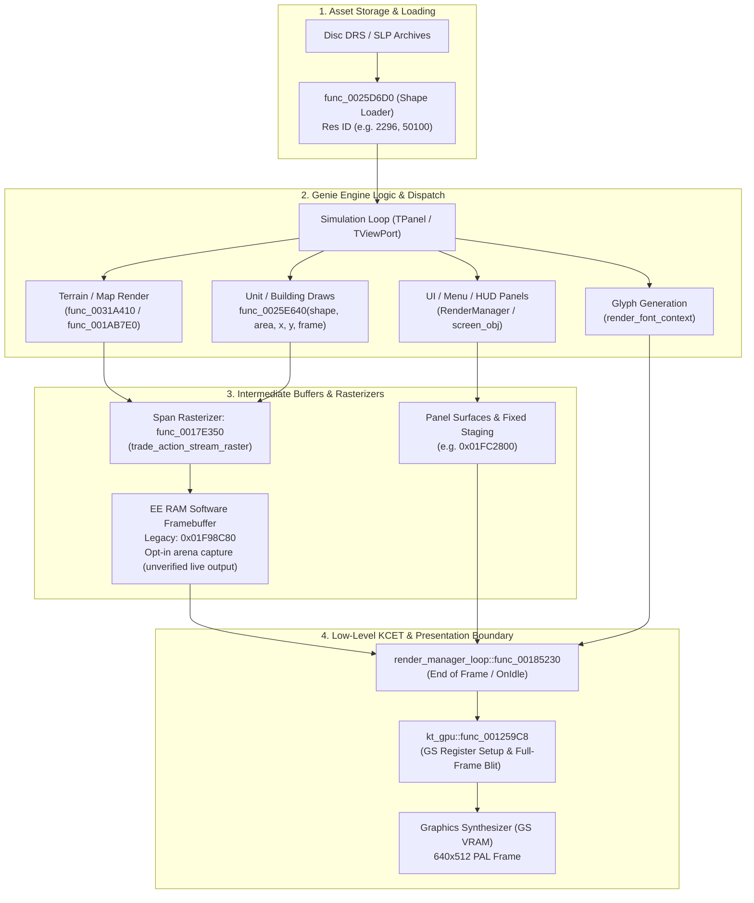

# High-Level Draw Seam Analysis: Sprites, Tiles, UI, and `kt_gpu`

This is the canonical contract for the planned GS-independent renderer. The original path is described in Portuguese in [`caminho-real-de-desenho-pipeline.md`](caminho-real-de-desenho-pipeline.md); implementation tasks and acceptance gates are in the [handoff](../plans/gs-independent-rendering.md), indexed by [docs/README.md](../README.md).

## 1. Executive Summary

An early hypothesis in the project design assumed that KCET's graphics abstraction module, **`kt_gpu`** (`src/kcet/kt_gpu.c`), might serve as the high-level drawing seam for sprites, terrain tiles, and UI elements.

However, detailed decompilation analysis (`samuelcaldas/age-of-empires-2-decomp`, commit `c3233fd4f`), disassembly investigation of `AOK.ELF` (SLES-50282), and runtime frame instrumentation (`docs/hd-render-evidence.md` and `docs/sot/hd-assets-strategy.md`) definitively confirm:

1. **`kt_gpu` is NOT the high-level drawing seam**:
   - `kt_gpu` is merely a low-level Graphics Synthesizer (GS) register/command dispatcher (~1.1 KiB, `0x00125800`–`0x00125C34`).
   - Its 29 command handlers configure low-level GS registers (`FRAME_1`, `FRAME_2`, `ZBUF_1`, `ZBUF_2`, `TEST_1`, color clamp) or dispatch raw GIF DMA packets.
   - It is invoked almost exclusively at the end of frames or during display initialization (`func_00388010` in `render_manager_loop.cpp` after `OnIdle()`) to set up framebuffers, sync VBLANK, and blit the whole completed software playfield buffer to the GS display buffer.

2. **The Actual High-Level Drawing Seams (Genie Engine & KCET Subsystems)**:
   - **Playfield & Terrain Tiles**: The game software-rasterizes terrain, fog of war, buildings, and in-world units into an 8-bit indexed EE RAM surface (`0x01F98C80` in the observed legacy 640×262 mode). `map_view_module` contains opt-in arena-backed relocation and expansion code; correct live expanded output remains unproven. The pixel span rasterizer is `func_0017e350` (`src/trade/trade_action_stream_raster.cpp`).
   - **Sprites (Units, Buildings, Projectiles)**:
     - **Resource Loading**: `func_0025D6D0(shape, name, resource_id)` (`src/render/render_manager_surfaces.cpp`).
     - **Shape Drawing**: `func_0025E640(shape, area, x, y, frame, flags)` (`src/render/render_helper_2184D0.cpp`). These shapes use PS2 packed formats (e.g., `4.1k` / `4.2k` containers or raw frame tables); some observed numeric IDs correspond to PC/HD SLP IDs (e.g. `2296`, `50100`). This does not prove universal correspondence.
   - **UI Elements & HUD Panels**:
     - **Panel Management & Hierarchy**: Handled by `RenderManager` and screen objects (`src/app/screen_manager.cpp`, `src/render/render_manager_screen.cpp`, `src/render/screen_obj.cpp`).
     - **HUD / Interface Sprites**: Drawn through the same `func_0025E640` shape draw seam into panel surfaces, or uploaded as small PSMT8 textures (e.g., 40×80 command buttons, 396×198 panels at `0x01FC2800`).
     - **Text / Fonts**: Each font glyph is uploaded separately as a small PSMT4 texture (6×6 to 18×11 px) via KCET DMA transfers and drawn as individual textured quads (`render_font_context.cpp`).

---

## 2. Anatomy and Disproof of `kt_gpu` as a Draw Seam

### 2.1 Code Structure of `kt_gpu.c`
In the matching decompilation (`src/kcet/kt_gpu.c`), `kt_gpu` consists of:
```c
void func_00125808(void *p, u64 *data); // ktGpuSetFrame1 (handler 23)
void func_00125858(void *p, u64 *data); // ktGpuSetFrame2 (handler 24)
void func_001258A8(void *p, u64 *data); // ktGpuSetZbuf1 (handler 25)
void func_001258F8(void *p, u64 *data); // ktGpuSetZbuf2 (handler 26)
void func_00125940(void *p, u32 *data); // ktGpuSetDrawRegisters (handler 27)
void func_00125988(void *p);             // ktGpuResetTestRegister (handler 28)
void func_001259C8(void *p, u8 *cmd, int flag); // ktGpuDispatchCommand (dispatcher)
```
The dispatcher `func_001259C8` indexes into a 29-pointer jump table `D_38C740`:
- Handlers 0–22: Low-level GS context updates, Vsync synchronization, and GIF packet transfers.
- Handlers 23–28: FRAME and ZBUF configuration registers.

### 2.2 Call Sites of `kt_gpu`
Across the entire `AOK.ELF` executable:
- There are **only two direct calls** to `func_001259C8`: both at `0x00388134` and `0x003881F0` inside `func_00388010`.
- `func_00388010` is called by `render_manager_loop.cpp` right after `self->OnIdle()`.
- What `func_00388010` actually does:
  - Configures the display buffer swap (`FRAME_1` / `FRAME_2`).
  - Sets up the hardware blit / DMA copy from the software-composed logical framebuffer (at FBP 256) into the active GS display buffer (640×512 PSMCT16).
- **Conclusion**: `kt_gpu` never sees individual units, terrain tiles, or UI buttons. Intercepting `kt_gpu` would only capture the final post-rasterized 640×448/512 frame transfer to the GS.

### 2.3 Legacy compatibility for `kt_gpu`
For the legacy/compatibility path only, when replacing or adapting `kt_gpu` at runtime:
1. **Command Routing**: Handlers 23–28 configure low-level GS registers (`FRAME_1/2`, `ZBUF_1/2`, `PRMODECONT`, `TEST_1/COLCLAMP`). If any command kind is not natively handled by a host GLES translator, it safely delegates to the original guest handler via `dispatchGuestBranch`.
2. **Deterministic Error Handling**: Invalid kinds (`>= 29`) trigger the authentic assertion failure at `kt_gpu.c:630` (`kind < numberof(func_list)`). Unhandled commands are never discarded silently.
3. **Threading & Context Boundary**: The GLES context is owned by the presenter thread (`SwitchGlesPresenter`). No OpenGL calls may be issued directly from guest execution hooks. Frames must be queued or passed through the runtime frame provider (`PS2Runtime::setNativeFrameProvider`).
4. **Coverage Reporting**: Installation logs must report honest state (`command handlers still forward to original game; native draw interceptor=not connected`) and never claim full native presentation prematurely.

---

## 3. High-Level Drawing Pipeline Map

The true flow of visual assets through the engine is structured as follows:



---

## 4. Specific Seams for Host Interception (`IRenderer`)

| Visual Component | Guest Seam / Entry Point | Format / Parameters | Recommended Host Override Strategy |
| :--- | :--- | :--- | :--- |
| **Map View / Terrain** | `game_hooks/src/map_view_module.cpp`<br/>`0x0031A410`, `0x001AB7E0`, `0x001ABAC0` | Indexed 8-bit surface and palette; opt-in arena-backed capture | **Partial**: hooks and RGBA composition exist, but live relocation parity, expanded terrain, and completed-frame timing remain acceptance gates. See the [viewport plan](../plans/expanded-viewport-native-implementation.md). |
| **Sprites (Units, Buildings)** | `func_0025D6D0` (loader)<br/>`func_0025E640` (draw) | `shape`: pointer to shape object<br/>`area`: target viewport/clip area<br/>`x, y`: screen coordinates<br/>`frame`: animation frame index<br/>`flags`: flip / transparency | Optional later substitution: verify resource identity and decode, suppress the original draw only on successful replacement, and preserve ordering with the map rasterizer. |
| **UI Panels & HUD Elements** | `screen_manager.cpp`<br/>`func_002FD5C0`, `func_002FC350`<br/>Panel draw hooks | Panel bounding boxes (`panel+0x14`, `panel+0x18`) and shape IDs (e.g. `50100` for main background) | First capture original UI above GS with verified source and ordering; later, anchor panels to display borders with matching input mapping. |
| **Text & Tooltips** | `render_font_context.cpp`<br/>Glyph draw callbacks | Glyph character code, font ID, screen position | Capture original glyphs and metrics before GS; native typography is optional later. |

---

## 5. Architectural Recommendations

1. **Do not write hooks inside `kt_gpu` for gameplay elements**:
   `kt_gpu` is relevant to legacy output and as evidence for required synchronization. The final native path must provide any required guest-visible completion and pacing independently of GS rendering.
2. **Preserve the Two-Seam Architecture**:
   - **Playfield Viewport Expansion Seam**: Managed via `aoe2::game_hooks::map_view` (relocating and expanding the native engine rasterizer).
   - **Entity & HUD High-Level Seam**: Intercept at `func_0025D6D0` / `func_0025E640` for sprite identity decoupling and asset substitution.

## 6. Renderer Integration Contract (Not Yet Implemented)

The shape entry point is now confirmed, but it is not yet connected to `IRenderer`. The integration must preserve the runtime's frame owner and avoid initializing another graphics context:

1. **Capture during guest execution**: a verified wrapper around `func_0025E640` may read the shape identity, frame, destination coordinates, clip area, flags, and current guest-frame generation. It must retain the original guest call unless a complete host replacement succeeds.
2. **Resolve only proven assets**: resolve a shape/frame to decoded RGBA using the resource ID established by the loader trace and a real palette. On missing identity, palette, frame, or decode data, report the host draw as unhandled so the original PS2 rasterizer runs.
3. **Queue immutable draw commands**: the guest hook must not issue GL/raylib calls. It can publish commands containing a retained texture/resource handle, source rectangle, destination rectangle, clip, tint/flags, and guest-frame generation. The queue must have explicit per-frame reset and bounded ownership so stale draws cannot leak into later frames.
4. **Consume in the existing presentation path**: the runtime's `NativeFrameProvider` / frame-compositor boundary owns final composition. The queue is consumed in guest draw order there, using the existing presentation backend and context. Do not initialize a second `GlesRenderer`/EGL context from a guest hook or add a second presenter.
5. **Preserve map/UI ordering and fallback**: map pixels, captured UI surfaces, and shape commands need a defined composition order and clipping against the same logical 640×448 frame before output scaling. Until that order is validated, shape substitution remains disabled and guest rendering remains authoritative.

### Current integration status

- `func_0025E640` is wrapped by the opt-in shape trace as a pass-through observer; no production renderer hook consumes it.
- `IRenderer::DrawSprite` accepts texture ID, source/destination rectangles, and tint, but `GlesRenderer` owns a separate context. It is not the current Switch `NativeFrameProvider` backend and must not be instantiated from the guest callback.
- `MapViewSession` composes map/UI frames in the existing runtime provider. That is the appropriate presentation boundary to extend once the draw queue and ordering are established.
- The first end-to-end proof should substitute one loader-correlated shape/frame, confirm a real palette and a bounded clip, enqueue it during guest execution, consume it once in the existing presenter, and verify that an asset miss invokes the original guest draw. Until this passes, logs must not report native shape presentation as active.

## 7. GS-independent presentation contract

### Goal and current boundary

The target covers boot, menus, transitions, gameplay, HUD, text, cursor and overlays. In the finished native path, no visual content, palette, texture, frame, or draw result may be obtained from GS VRAM, GS framebuffer capture, GIF packet interpretation, or the GS rasterizer. Guest-visible frame completion and timing still need an independently verified replacement; merely suppressing GS calls can deadlock the game. The legacy path remains a comparison tool during development.

The current implementation does **not** satisfy that goal. `MapViewSession` installs `NativeFrameProvider` only on Switch. Its `CaptureUi` calls `PS2Runtime::captureHostUiFrame`, which delegates to `m_gs.captureHostUiFrame`; an owned RGBA result does not make its source GS-independent. The desktop `FrameCompositor` receives a GS-derived legacy frame. Switch `UploadFrame` presents a black frame while the native provider returns no frame. None of these behaviors establishes complete native presentation or strict failure. The native map capture and UI capture also lack a demonstrated common completed-frame identity (`CaptureUi` currently assigns a constant submission value). See the [Switch checkpoint](../switch-manual-navigation-checkpoint.md) and [viewport plan](../plans/expanded-viewport-native-implementation.md) for actual observations.

### Frame lifecycle and ownership

The intended flow is **guest execution → verified high-level capture → ordered frame assembly → immutable owned RGBA frame → existing platform presenter**. The following is a required interface contract, not a claim that an implementation exists:

1. A guest-frame boundary must be proven from actual execution, including scheduler yields and screen transitions. The producer starts a monotonically increasing generation at that boundary, records drawing in guest order, then seals only after all sources for that generation are complete. A callback returning to host code alone is not proof of completion.
2. Each map snapshot, UI surface, palette and command belongs to that generation and its screen/panel lifetime. Copy mutable guest data at a verified safe point into bounded host-owned storage; never retain guest pointers or references to scratch buffers after the guest resumes. Associate resource handles with a lifetime that outlives every queued use. A screen change, teardown, or failed generation invalidates pending work and input layout.
3. Frame assembly consumes the sealed sequence in observed order. Surface updates, fills, map output, shapes, glyphs, cursor and overlays must preserve their relative ordering, clipping and alpha; no universal rule such as “all UI after map” is assumed until traces establish it. Treat map pixels containing units as already rasterized: replacing a sprite requires preventing the corresponding original rasterization and preserving intervening draws. A late overlay alone duplicates or incorrectly occludes it.
4. Define coordinates, pitch, pixel format, palette and alpha interpretation for each source from evidence. Reject integer overflow, out-of-range guest spans, impossible dimensions, invalid frame indices, missing palettes and expired resources. Convert to one documented host RGBA representation before composition. Apply the output transform once; publish its matching inverse input layout only for the successfully presented generation.
5. The existing presentation owner consumes an immutable host-owned frame with width, height, stride and storage lifetime through completion of upload. Guest hooks do not call GL or create contexts. Adapt the runtime's existing provider/presenter for all supported platforms; do not create a second context or competing presenter. Queue limits and backpressure must be explicit and bounded; never silently drop a required draw or mix generations.
6. Synchronization and teardown must ensure that neither the presenter nor guest accesses released state. Install providers before guest execution, clear them after execution stops, and handle resize, dock transitions and panel destruction as generation boundaries. Validate whether existing runtime locking and scheduler behavior meet these requirements before relying on them.

The first target is original PS2 appearance and functionality without GS. HD assets, alternate fonts and wider layouts are optional later improvements, not prerequisites. Host asset substitution is disabled until its decode, original-call replacement, ownership, composition order and fallback are verified end to end.

### Coverage and unresolved evidence

| Content | Known starting point | Required proof before native coverage can be claimed |
| --- | --- | --- |
| Boot, loading, menus, transitions | Existing presentation and `func_0021A960` are investigation starting points. | Enumerate fills, images, animations and screen transitions; establish source pixels, palette, clipping, order and frame boundaries without GS capture. |
| Map, terrain, units, fog | Guest software surface and opt-in `map_view` snapshots exist. | Prove playfield identity, palette, completion timing and legacy-size parity; demonstrate revealed terrain and objects in a real expanded mission. Minimap submission is not playfield submission. |
| HUD, minimap, tooltips, dialogs | Panel/shape paths and `func_0021A960` are candidates, not complete interfaces. | Trace all surfaces and draws, including map overlap, fills and transparency; correlate layout and input hit tests. |
| Text | Glyph uploads have been observed; high-level text and glyph seams are not fully characterized. | Capture PS2 glyphs and metrics or an equivalent faithful source before GS; verify color, spacing, clipping, languages and overlays. A TTF replacement is optional. |
| Cursor and overlays | Input/presentation transforms exist; visual producer and order require tracing. | Verify cursor source, position, visibility, clipping and interaction with menus, tooltips and screen changes. |
| Frame pacing and synchronization | Legacy runtime uses VSYNC/GS-related paths. | Identify all guest-visible completion, interrupt and wait dependencies; provide equivalent progress without interpreting GS drawing. |

A missing item is **unknown**, not an empty layer. Record a concrete trace and source/decomp reference for each accepted seam; do not infer a universal asset-ID correspondence from a few matches.

### Modes, diagnostics and exit criteria

- **Legacy/reference:** existing GS-derived presentation may be used for screenshots and investigation. It is not evidence for native acceptance.
- **Native strict (to implement):** require a complete sealed native frame and verified synchronization. Missing capture, unsupported draw, resource failure, stale generation, queue overflow or invalid layout produces a named diagnostic and a failed run; it must not sample GS, silently reuse a previous frame, or substitute black for missing content. Intentional black screens must be represented by a verified draw/clear. Waiting before the first frame needs a bounded, explicit startup state, not a successful frame.
- The final integration gate disables or instruments GS visual processing and fails on any access from native frame production. Test initialization and waits as well as drawing, so an apparently native frame cannot hide reliance on GS side effects. Compatibility execution may retain legacy behavior, but release of the GS-independent path requires all scenario gates in the [handoff](../plans/gs-independent-rendering.md).
