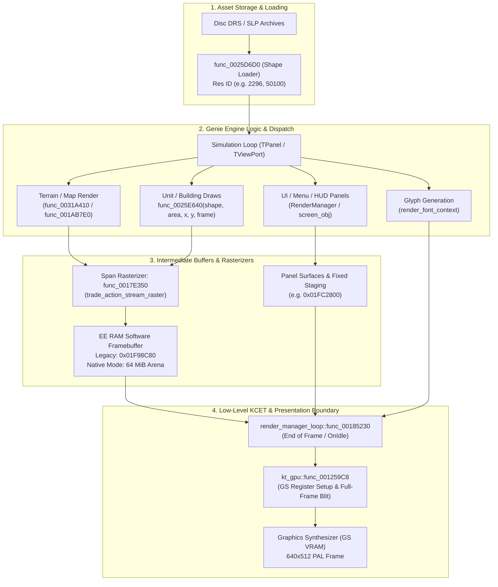

# High-Level Draw Seam Analysis: Sprites, Tiles, UI, and `kt_gpu`

## 1. Executive Summary

An early hypothesis in the project design assumed that KCET's graphics abstraction module, **`kt_gpu`** (`src/kcet/kt_gpu.c`), might serve as the high-level drawing seam for sprites, terrain tiles, and UI elements.

However, detailed decompilation analysis (`samuelcaldas/age-of-empires-2-decomp`, commit `c3233fd4f`), disassembly investigation of `AOK.ELF` (SLES-50282), and runtime frame instrumentation (`docs/hd-render-evidence.md` and `docs/sot/hd-assets-strategy.md`) definitively confirm:

1. **`kt_gpu` is NOT the high-level drawing seam**:
   - `kt_gpu` is merely a low-level Graphics Synthesizer (GS) register/command dispatcher (~1.1 KiB, `0x00125800`–`0x00125C34`).
   - Its 29 command handlers configure low-level GS registers (`FRAME_1`, `FRAME_2`, `ZBUF_1`, `ZBUF_2`, `TEST_1`, color clamp) or dispatch raw GIF DMA packets.
   - It is invoked almost exclusively at the end of frames or during display initialization (`func_00388010` in `render_manager_loop.cpp` after `OnIdle()`) to set up framebuffers, sync VBLANK, and blit the whole completed software playfield buffer to the GS display buffer.

2. **The Actual High-Level Drawing Seams (Genie Engine & KCET Subsystems)**:
   - **Playfield & Terrain Tiles**: Pure software rasterization by Ensemble Studios' Genie Engine (`TMapArea` / `TViewPort`). The game draws isometric terrain, fog of war, buildings, and in-world units directly into an 8-bit paletted software framebuffer located in EE RAM (`0x01F98C80` in legacy 640×262 mode, or redirected to the 64 MiB expanded arena in Native mode via `map_view_module`). The pixel span rasterizer is `func_0017e350` (`src/trade/trade_action_stream_raster.cpp`).
   - **Sprites (Units, Buildings, Projectiles)**:
     - **Resource Loading**: `func_0025D6D0(shape, name, resource_id)` (`src/render/render_manager_surfaces.cpp`).
     - **Shape Drawing**: `func_0025E640(shape, area, x, y, frame, flags)` (`src/render/render_helper_2184D0.cpp`). These shapes are parsed from PS2 packed shape formats (e.g., `4.1k` / `4.2k` containers or raw frame tables) with numeric IDs matching PC/HD SLP IDs (e.g. `2296`, `50100`).
   - **UI Elements & HUD Panels**:
     - **Panel Management & Hierarchy**: Handled by `RenderManager` and screen objects (`src/app/screen_manager.cpp`, `src/render/render_manager_screen.cpp`, `src/render/screen_obj.cpp`).
     - **HUD / Interface Sprites**: Drawn through the same `func_0025E640` shape draw seam into panel surfaces, or uploaded as small PSMT8 textures (e.g., 40×80 command buttons, 396×198 panels at `0x01FC2800`).
     - **Text / Fonts**: Each font glyph is uploaded separately as a small PSMT4 texture (6×6 to 18×11 px) via KCET DMA transfers and drawn as individual textured quads (`render_font_context.cpp`).

---

## 2. Anatomy and Disproof of `kt_gpu` as a Draw Seam

### 2.1 Code Structure of `kt_gpu.c`
In the matching decompilation (`src/kcet/kt_gpu.c`), `kt_gpu` consists of:
```c
void func_00125808(void *p, u64 *data); // ktGpuSetFrame1 (handler 23)
void func_00125858(void *p, u64 *data); // ktGpuSetFrame2 (handler 24)
void func_001258A8(void *p, u64 *data); // ktGpuSetZbuf1 (handler 25)
void func_001258F8(void *p, u64 *data); // ktGpuSetZbuf2 (handler 26)
void func_00125940(void *p, u32 *data); // ktGpuSetDrawRegisters (handler 27)
void func_00125988(void *p);             // ktGpuResetTestRegister (handler 28)
void func_001259C8(void *p, u8 *cmd, int flag); // ktGpuDispatchCommand (dispatcher)
```
The dispatcher `func_001259C8` indexes into a 29-pointer jump table `D_38C740`:
- Handlers 0–22: Low-level GS context updates, Vsync synchronization, and GIF packet transfers.
- Handlers 23–28: FRAME and ZBUF configuration registers.

### 2.2 Call Sites of `kt_gpu`
Across the entire `AOK.ELF` executable:
- There are **only two direct calls** to `func_001259C8`: both at `0x00388134` and `0x003881F0` inside `func_00388010`.
- `func_00388010` is called by `render_manager_loop.cpp` right after `self->OnIdle()`.
- What `func_00388010` actually does:
  - Configures the display buffer swap (`FRAME_1` / `FRAME_2`).
  - Sets up the hardware blit / DMA copy from the software-composed logical framebuffer (at FBP 256) into the active GS display buffer (640×512 PSMCT16).
- **Conclusion**: `kt_gpu` never sees individual units, terrain tiles, or UI buttons. Intercepting `kt_gpu` would only capture the final post-rasterized 640×448/512 frame transfer to the GS.

---

## 3. High-Level Drawing Pipeline Map

The true flow of visual assets through the engine is structured as follows:



---

## 4. Specific Seams for Host Interception (`IRenderer`)

| Visual Component | Guest Seam / Entry Point | Format / Parameters | Recommended Host Override Strategy |
| :--- | :--- | :--- | :--- |
| **Map View / Terrain** | `game_hooks/src/map_view_module.cpp`<br/>`0x0031A410`, `0x001AB7E0`, `0x001ABAC0` | Indexed 8-bit paletted map buffer relocated to 64 MiB arena (`state.relocation.base`) | **Already Implemented**: Native Mode intercepts map panel bounds, redirects scanlines to expanded memory, and extracts 1:1 RGBA frames via `MapViewCompositor`. |
| **Sprites (Units, Buildings)** | `func_0025D6D0` (loader)<br/>`func_0025E640` (draw) | `shape`: pointer to shape object<br/>`area`: target viewport/clip area<br/>`x, y`: screen coordinates<br/>`frame`: animation frame index<br/>`flags`: flip / transparency | Intercept `func_0025E640`: map numeric resource ID (`shape->resource_id`) and frame index to modern HD SLP/PNG/SMX textures in Host GPU VRAM, bypassing the software span blitter. |
| **UI Panels & HUD Elements** | `screen_manager.cpp`<br/>`func_002FD5C0`, `func_002FC350`<br/>Panel draw hooks | Panel bounding boxes (`panel+0x14`, `panel+0x18`) and shape IDs (e.g. `50100` for main background) | Anchor HUD panels to display borders (resource bar top, command panel bottom) and draw UI quads via host `IRenderer`. |
| **Text & Tooltips** | `render_font_context.cpp`<br/>Glyph draw callbacks | Glyph character code, font ID, screen position | Replace low-resolution PSMT4 bitmap font quad transfers with native FreeType/TrueType typography. |

---

## 5. Architectural Recommendations

1. **Do not write hooks inside `kt_gpu` for gameplay elements**:
   `kt_gpu` should only be used to handle presentation sync, double-buffering, and whole-screen presentation if emulating GS output.
2. **Preserve the Two-Seam Architecture**:
   - **Playfield Viewport Expansion Seam**: Managed via `aoe2::game_hooks::map_view` (relocating and expanding the native engine rasterizer).
   - **Entity & HUD High-Level Seam**: Intercept at `func_0025D6D0` / `func_0025E640` for sprite identity decoupling and asset substitution.
