# Investigação e Especificação Técnica: Multiplayer e Rede Local (LAN) no Runtime Recompilado

Este documento detalha as descobertas da investigação nos binários das três versões de *Age of Empires II* (`game/SLES-50282/`, `game/classic-pc/` e `game/hd-edition/`), na web e na codebase de descompilação, estabelecendo a estratégia técnica para habilitar o modo multijogador em rede local (LAN) no projeto de recompilação estática multiplataforma (Desktop, Switch e Android).

---

## 1. Descobertas e Anatomia das Três Edições

### 1.1 Versão PS2 PAL (`game/SLES-50282/`)

Ao analisar `AOK.ELF`, os módulos em `MODULES2/` e os overlays em `EN/`:
1. **O Porte é Direto do PC com Camada de Compatibilidade DirectPlay**:
   - O código do jogo original de PC dependia estritamente da API **Microsoft DirectPlay 4/5/6** (Win32 COM).
   - Para portar o jogo ao PS2 sem reescrever a lógica interna de sincronização de rede, matchmaking e turnos (lockstep determinístico da Ensemble Studios), a equipe da Konami/KCET implementou um emulador em C++ da interface COM chamado **`DirectPlay Compatible Interface`** no arquivo fonte `mydplay.cpp` (localizado em `0x338140` no ELF).
   - O banner de log no executável diz explicitamente:
     ```
     mydplay.cpp line:%d, Error at Create thread: th_Receiver
     DirectPlay Compatible Interface
     err! il_sendto(%d)
     dplay: receive buffer full/size:%d
     ```
2. **Infraestrutura de Transporte Física no PS2**:
   - Em vez de sockets TCP/IP padrão sobre placa de rede (Ethernet), o jogo no PS2 utilizava a interface **Sony i.LINK (IEEE 1394 / FireWire)** através das bibliotecas:
     - `ILINK.IRX`: Driver do controlador de hardware FireWire.
     - `ILSOCK.IRX` / `socketee.c`: Implementação de sockets proprietários (`sceILsockBind`, `sceILsockConnect`, `sceILsockSend`, `sceILsockRecv`).
     - A comunicação ocorria via broadcast e pacotes peer-to-peer usando o endereço EUI-64 do chip FireWire (`EUI64=%04x:%04x`).
3. **Módulos de Internet Inativos / Prototipados**:
   - O disco contém módulos como `SMAP.IRX` (Ethernet NIC), `AVETCP.IRX` (Pilha TCP/IP) e `BSDSOCKI.IRX` (API estilo BSD Sockets), além do overlay `LOBBY_CD.BIN`.
   - O `LOBBY_CD.BIN` tentava conectar ao serviço extinto da Konami (`loaok1.konamionline.com`, autenticação `KLCLS`), mas o jogo nas lojas só permitia partidas de 2 jogadores conectando dois consoles PS2 modelo Fat através do cabo i.LINK.
4. **Telas e Máquina de Estado Multijogador**:
   - Todas as telas de rede do PC continuam intactas no executável MIPS:
     - `MP Startup Screen` (VRAM `0x4D1710`, chamada em `0x2FD85C`)
     - `Join Screen` (VRAM `0x4D1700`)
     - `MP Setup Screen` (VRAM `0x4D16F0`)
     - `MP Setup Game Screen` / `MP Setup Civ Screen` / `Multiplayer Wait Screen`

---

### 1.2 Versão Classic PC RTM 1999 (`game/classic-pc/`)

1. **Arquitetura de Rede**:
   - O executável `empires2.exe` liga-se à `DPLAYX.DLL` (DirectPlay 6.1a / DirectX 7.0).
   - Suporta múltiplos Service Providers do DirectPlay:
     - **DirectPlay TCP/IP Connection For DirectPlay**: Jogo em rede local (LAN via UDP/TCP porta 47624 e faixa 2300-2400) ou Internet por IP direto.
     - **IPX Connection For DirectPlay**: LAN via protocolo IPX.
     - **Modem / Serial Connection**: P2P direto via linha telefônica ou cabo serial null-modem.
2. **Modelo de Sincronização**:
   - *Peer-to-Peer Lockstep*: O jogo não tem servidor dedicado. Todos os clientes trocam mensagens de comandos (ordens aos aldeões, exércitos) a cada turno de simulação (tick de rede). Se um jogador perder pacotes ou atrasar, a mensagem clássica de *"Waiting for players..."* surge na tela.

---

### 1.3 Versão HD Edition 2013 (`game/hd-edition/`)

1. **Substituição Completa do DirectPlay por Steamworks**:
   - Na versão HD (v5.8), o DirectPlay foi removido em favor da `steam_api.dll` (Steam Networking P2P & Steam Matchmaking Lobby).
   - O sistema de simulação em lockstep permaneceu idêntico, mas o transporte passou a trafegar via sockets UDP criptografados e retransmitidos pela rede da Valve.

---

## 2. Abordagens Possíveis para Habilitar Rede Local no Recomp

Para o runtime estático multiplataforma, temos duas abordagens viáveis:

```mermaid
flowchart TD
    subgraph OpcaoA["Opção A: Hook na camada mydplay.cpp (Recomendada)"]
        simA["Simulação do Jogo (AOK.ELF / Recomp)"] --> dplay["DirectPlay Interface (mydplay.cpp / 0x338140)"]
        dplay -- "Hook KCET Boundary" --> net_bridge["aoe2::net::UdpLanTransport"]
        net_bridge --> bsd["Sockets UDP/IP Multiplataforma (Linux, Windows, Switch, Android)"]
    end

    subgraph OpcaoB["Opção B: Emular ILSOCK no IOP"]
        simB["Simulação do Jogo (AOK.ELF / Recomp)"] --> dplayB["mydplay.cpp"]
        dplayB --> ilsock["sceILsock* Calls"]
        ilsock --> rpc["SIF RPC para IOP"]
        rpc --> iop_emu["Emulador de ILSOCK.IRX + ILINK.IRX"]
        iop_emu --> bsdB["Traduz EUI64 para UDP"]
    end
```



### Por que a **Opção A (Hook na Fronteira KCET)** é superior?
1. **Segue a regra do projeto (ADR 0001)**: Nunca emular subsistemas inferiores (IOP/SIF/drivers) quando é possível interceptar na fronteira de alto nível (como fizemos com `kt_mouse` e faremos com `kt_gpu`).
2. **Elimina a trava de 2 jogadores do i.LINK**: O i.LINK do PS2 suportava tipicamente conexões ponto-a-ponto de 2 consoles. Ao interceptar os métodos de `mydplay.cpp`, podemos estender a sessão para 4 ou 8 jogadores (como no PC original).
3. **Multiplataforma Nata**: Utiliza sockets UDP padrão compatíveis com `libnx` (Switch), `NDK` (Android) e desktop Linux/Windows.

---

## 3. Especificação do Subsistema `aoe2::net`

Para permitir que outros agentes implementem a funcionalidade de forma modular:

### 3.1 Contrato da Camada de Transporte (`network_transport.hpp`)

```cpp
namespace aoe2::net {

struct PeerAddress {
    uint32_t ip{0};     // IPv4 network-byte-order
    uint16_t port{0};
};

struct NetPacket {
    PeerAddress source;
    std::vector<uint8_t> data;
};

class INetworkTransport {
public:
    virtual ~INetworkTransport() = default;

    virtual bool Initialize(uint16_t local_port) = 0;
    virtual void Shutdown() = 0;

    virtual bool Broadcast(const uint8_t* data, size_t size, uint16_t target_port) = 0;
    virtual bool SendTo(const PeerAddress& target, const uint8_t* data, size_t size) = 0;
    virtual std::optional<NetPacket> PollPacket() = 0;
};

} // namespace aoe2::net
```

### 3.2 Protocolo de Descoberta Local (LAN Beacon)
- **Porta UDP Padrão**: `23000` (ou faixa configurável).
- **Descoberta de Sessão**:
  1. Quando o jogador entra no menu de Lobby / Rede Local, o cliente envia um pacote `LAN_DISCOVER_REQUEST` em broadcast (`255.255.255.255`).
  2. O jogador que hospeda (Host) responde com `LAN_SESSION_INFO` contendo:
     - Nome da Sessão (UTF-8).
     - Jogadores atuais / Máximo (ex: 1/8).
     - Mapa, tamanho, modo de jogo e versão da engine.
  3. A lista de sessões no menu é populada em tempo real.

### 3.3 Interceptação de `mydplay.cpp` via `game_overrides`

No arquivo `game_hooks/src/kcet_net_overrides.cpp`:
- Substituir o método de inicialização `0x338140` e o laço da thread receptora (`th_Receiver`).
- Interceptar os métodos de envio e recepção da tabela virtual (`0x321AF4` .. `0x321CEC`):
  - Em vez de chamar `sceILsockSend` e empacotar para o cabo FireWire, despacha o payload bruto de lockstep da Genie Engine diretamente para `aoe2::net::INetworkTransport::SendTo`.
  - A thread receptora alimenta a fila circular de pacotes do jogo (`dplay: receive buffer`), garantindo que os ticks de simulação aconteçam sem alterações na lógica interna.

---

## 4. Roteiro Passo a Passo para os Próximos Agentes

1. **Fase 1: Implementação da Camada `aoe2_net`**:
   - Criar `network/include/aoe2/net/udp_lan_transport.hpp` e `network/src/udp_lan_transport.cpp` com suporte a sockets não-bloqueantes multiplataforma (BSD Sockets padrão para Linux, Windows `Winsock`, Switch `libnx` e Android).
   - Criar testes de unidade C++ validando handshake e troca de pacotes em localhost (`tests/cpp/net_tests.cpp`).

2. **Fase 2: Resolução de Endereços de Hook de Rede**:
   - Estender `tools/resolve_kcet_hooks.py` para localizar dinamicamente os símbolos de `mydplay.cpp` e registrar os endereços no `kcet_hooks.ini` ignorado (ex: `kcet.dplay.init = 0x338140`).

3. **Fase 3: Implementação dos Hooks KCET**:
   - Implementar `game_hooks/src/kcet_net_overrides.cpp`.
   - Garantir que ao clicar em "Multiplayer" no menu principal, o jogo carregue as telas de setup de rede em vez de travar por falta do driver i.LINK.
