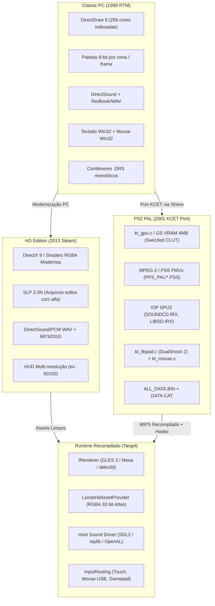

# Evolução dos Subsistemas e Pipeline de Assets: Som, Vídeo, Texturas e Controles

Este documento é a **Fonte Canônica de Verdade (SOT)** para orientar os agentes no entendimento profundo de como os quatro subsistemas essenciais (**Vídeo/Gráficos**, **Texturas/Paletas**, **Áudio/Música** e **Controles/Input**) foram projetados originalmente no PC, portados para o PlayStation 2 pela KCET, retrabalhados na versão HD (2013) e como devem ser implementados na arquitetura de recompilação estática multiplataforma (Desktop, Switch e Android).

---

## 1. Visão Geral da Linhagem das Três Edições



---

## 2. Subsistema de Vídeo e Renderização

### 2.1 Classic PC (1999)
- **API**: Microsoft DirectDraw 6.0 (`IDirectDraw4` / `IDirectDrawSurface`).
- **Resoluções**: Modos fixos 4:3 comutada por modo exclusivo (640x480, 800x600, 1024x768, 1280x1024).
- **Modelo de Blit**: Software Blitter de 8 bits desenhando em backbuffers na memória RAM e realizando flip de página para a memória de vídeo.

### 2.2 PlayStation 2 PAL (2001)
- **API / Hardware**: Sem DirectDraw; substituído pela camada **KCET `kt_gpu.c`** comunicando-se diretamente com o **Graphics Synthesizer (GS)** da Sony via canais DMA (VIF1/GIF).
- **Resolução**: Modo fixo de TV PAL (640x512 entrelaçado / 640x480 NTSC).
- **Restrição Crítica**: O GS possui apenas **4 MB de VRAM total embutida**. Isso obrigou a KCET a dividir a tela em faixas e gerenciar paginação de texturas por demanda através de pacotes GIF.
- **Cinematics (Vídeo)**: Substituição dos arquivos `.AVI` legados do PC por vídeos em formato **PlayStation Stream (`.PSS`)** (MPEG-2 codificado com multiplexação de áudio SPU2) carregados na pasta `PPS_PAL/` (`AGE2_2.PSS`, `ESLOGO_2.PSS`, `MSLOGO_2.PSS`) e decodificados via `pss_audiodec.c`.

### 2.3 HD Edition (2013)
- **API**: Direct3D 9Ex com suporte a shaders HLSL e renderização de composição com canal alfa verdadeiro.
- **HUD Widescreen**: Introdução de artes de interface adaptadas para widescreen (720p, 1080p e superiores), evitando o esticamento da proporção 4:3.

### 2.4 Especificação para o Recomp
- **Alvo**: `aoe2::renderer::IRenderer` via **OpenGL ES 3.0 / Mesa**.
- **Regra**: **Zero emulação do Graphics Synthesizer do PS2.**
- **Interceptação**: As rotinas de desenho de sprites e blocos da engine chamavam o shim `kt_gpu.c` (VRAM `0x125800`). Em vez de emitir microprogramas VU1 ou pacotes GIF para o GS, o recomp substitui essas funções via `game_overrides` e despacha chamadas com coordenadas normalizadas para o `IRenderer`.

---

## 3. Subsistema de Texturas, Sprites e Paletas (Evolução Cronológica)

O pipeline de cores e texturas foi o componente que sofreu a transformação mais radical entre as três edições:

| Aspecto | Classic PC (1999) | PS2 PAL (2001) | HD Edition (2013) | Recomp Target |
| :--- | :--- | :--- | :--- | :--- |
| **Armazenamento** | Monolítico `.drs` (`graphics.drs`, `interfac.drs`) | Monolítico proprietário (`ALL_DATA.BIN` + `DATA.CAT`) | Arquivos soltos (*loose*) indexados por ID numérico (`resources/_common/drs/`) | Arquivos soltos em `assets/` externo |
| **Profundidade de Cor** | 8 bits (256 cores indexadas) | 4 bits (16 cores) e 8 bits (256 cores) | Truecolor 32-bit RGBA com canal alfa pré-multiplicado | Texturas GPU RGBA 32-bit / Atlases |
| **Formato de Sprite** | SLP clássico | SLP adaptado compactado em `ALL_DATA.BIN` | **SLP 2.0N** (cabeçalho `2.0N` com frames arbitrários) | Decodificado via `slp_decoder` para GPU |
| **Tratamento de Paletas** | Arquivos `.pal` / `.col` (JASC-PAL de 256 cores RGB) | **CLUT Swizzling de Hardware no GS** (reordenação de índices de bytes em hardware) | Cores RGB diretamente integradas ou paleta de referência | Shaders modernos de cor de jogador (*Player Color*) |

### O Desafio do CLUT Swizzling no PS2:
Na versão PS2, a memória do GS armazena tabelas de consulta de cores (CLUT - *Color Look-Up Table*) de forma não-linear devido à organização de barramento do GS (tils de 32 bits). O código descompilado em `trade_action_helper_21B440.cpp` revela a fórmula exata do algoritmo de swizzling da KCET:
```cpp
// Fórmula do swizzle de paleta 256 cores para o GS do PS2:
int swizzled_idx = ((i >> 5) << 5) | (((i >> 4) & 1) << 3) | (((i >> 3) & 1) << 4) | (i & 7);
```
**Diretriz para o Recomp**: Descartar totalmente o algoritmo de swizzle do GS. Ao carregar sprites e paletas da HD Edition (`SLP 2.0N`), o parser lê os bytes diretamente e converte os pixels para RGBA 32-bit linear no host, alimentando texturas `GL_RGBA8`. Para a análise detalhada dos artefatos visuais observados nos botões do HUD e o roadmap de modernização com OpenGL ES 3, consulte [`docs/sot/hud-artifacts-clut-swizzle.md`](hud-artifacts-clut-swizzle.md).

---

## 4. Subsistema de Áudio e Música

### 4.1 Classic PC (1999)
- **Efeitos**: Microsoft DirectSound (`dsound.dll`), reproduzindo arquivos WAV mono/estéreo a 22050 Hz / 44100 Hz indexados no `sounds.drs`.
- **Música**: Faixas de áudio CD-DA (Redbook Audio) no leitor óptico, posteriormente migradas para MP3 na pasta `Sound/stream/`.

### 4.2 PlayStation 2 PAL (2001)
- **Arquitetura de Hardware**:
  - O Emotion Engine (EE) não reproduz áudio. Todo o áudio é processado pelo coprocessador **IOP** ligado ao processador de som dedicado **SPU2 (Sound Processing Unit 2)**, que possui 2 MB de Sound RAM própria.
  - A KCET utilizou os drivers `.IRX`:
    - `LIBSD.IRX`: Biblioteca de baixo nível para controle do chip SPU2.
    - `SOUNDCD.IRX` / `SDRDRV.IRX`: Driver de som de streaming da Konami para tocar música e efeitos a partir do leitor de DVD.
    - `SDSTR.IRX`: Driver de fluxo contínuo de canais de voz.
  - Formato: Efeitos compactados em ADPCM proprietário do SPU2 da Sony (VAG).

### 4.3 HD Edition (2013)
- **Efeitos**: Arquivos WAV limpos em PCM padrão em `resources/_common/drs/sounds/` e `interface/`.
- **Música**: Arquivos MP3 de alta taxa de bits em `resources/_common/sound/music/` (`xmusic1.mp3` a `xmusic23.mp3`).

### 4.4 Especificação para o Recomp
- **Alvo**: Bypasse de 100% dos módulos IRX do IOP (`SOUNDCD.IRX`, `LIBSD.IRX`).
- **Implementação**:
  - A interface `aoe2::audio::IAudioBackend` (alimentada por SDL2_mixer, raylib audio ou miniaudio) consome diretamente os arquivos WAV da pasta `assets/sound/` e MP3 de `assets/music/`.
  - As chamadas da engine que solicitavam a reprodução de um som pelo seu ID numérico são interceptadas em `game_hooks/src/kcet_sound_overrides.cpp`.

---

## 5. Subsistema de Controles e Entrada

### 5.1 O Desafio Original no PS2: DualShock 2 vs Teclado e Mouse
O PS2 apresentava dois paradigmas de entrada completamente opostos para um RTS:
1. **Mouse e Teclado USB (`kt_mouse.c` e `kt_keybd.c`)**:
   - A KCET implementou drivers de periféricos USB no IOP (`usbd.irx`, `usbmouse.irx`, `usbkeybd.irx`).
   - O código do jogo comunicava-se via SIF RPC para obter pacotes de 8 bytes de estado de mouse (delta X, delta Y, botões). Esse modo preservava a experiência do PC original em 1:1.
2. **DualShock 2 (`kt_libpad.c`)**:
   - Como a maioria dos jogadores de console não possuía mouse USB, a KCET criou um sistema de controle de RTS por gamepad:
     - O analógico esquerdo movimenta o cursor virtual pela tela com aceleração e zona morta.
     - Botões físicos foram mapeados para ações rápidas de unidade: botão X para selecionar/atacar/construir, quadrado para menu radial de ordens, botões de ombro (L1/R1) para alternar entre centros urbanos e exércitos.

### 5.2 Especificação para o Recomp Multiplataforma

```
[Touchscreen Switch / Android] ----> TouchGestureTranslator ──┐
[Mouse USB / Desktop] -------------> UsbMouseTranslator ─────┼──> GuestMouseAdapter ──> [Simulação AoE2]
[DualShock / Pro Controller] ------> HostGamepadTranslator ──┘
```

1. **Desktop**: Mouse e teclado do host alimentam diretamente o modelo de mouse RPC (`UsbMouseRpcModel`).
2. **Nintendo Switch**:
   - *Modo Portátil*: A tela capacitiva do Switch é traduzida via `TouchGestureTranslator` e `SurfaceMapping` diretamente em cliques de mouse virtual no jogo.
   - *Modo Docked*: Suporte automático a mouse/teclado conectados nas portas USB do dock ou controle via analógico do Pro Controller / Joy-Con.
3. **Android**: Toques multitouch na tela alimentam o `TouchGestureTranslator`.

---

## 6. Sumário de Diretrizes de Implementação para os Agentes

1. **Vídeo e Gráficos**:
   - Conectar o loop de apresentação à interface `aoe2::renderer::IRenderer`.
   - Ignorar qualquer chamada para registradores do GS (`VIF1`, `GIF`, `PMODE`).
2. **Texturas**:
   - Implementar o decodificador `slp_decoder.cpp` que lê os arquivos `SLP 2.0N` fornecidos pelo `LooseHdAssetProvider` e faz upload para texturas OpenGL ES 3.0.
   - Nunca tentar converter paletas para a memória do GS nem aplicar o algoritmo de swizzle.
3. **Áudio**:
   - Implementar `kcet_sound_overrides.cpp` ouvindo as requisições de áudio por ID numérico e despachando os arquivos WAV/MP3 da pasta de assets para o backend de som do host.
4. **Controles**:
   - Unificar a entrega de eventos via camada de entrada existente em `aoe2::input`, permitindo que toque, mouse e analógico controlem o cursor com precisão em todas as telas.
