# Nintendo Switch Target Porting Blueprint: Post-Recompilation Architecture

## 1. Overview & Context

This document is the architectural blueprint for completing a functional, release-quality native Nintendo Switch homebrew port (`.nro`) once the original game code is statically recompiled.

While the primary recompilation pipeline (`Ghidra` + `PS2Recomp` / `ps2_recomp`) translates MIPS R5900 machine instructions and VU0 macro code into C++ functions running on ARM64 (`aarch64`), **a statically recompiled binary alone is not an executable game**. Translating instructions is only the first stage; console homebrew requires bridging Horizon OS system services, display pipelines, memory modes, and peripherals without the full desktop OS runtime environment.

This blueprint synthesizes lessons learned from prior art across major console recompilation projects on Switch:
- **`Zelda64Recomp` / `N64ModernRuntime`** (`ultramodern` & `librecomp`): Storage abstraction, multi-threading on Horizon OS, audio streaming.
- **`DK64Recomp-NX`**: Porting recompiled code via devkitPro's `switch-mesa` OpenGL ES pipeline, controller hot-plugging.
- **`SwitchWakerHD`**: Native Switch platform layer, touchscreen-to-pointer translation, title-mode memory management.
- **`RampageRE`**: PS2-to-Switch static recompilation runner, GLES presentation, and SDMC asset root resolution.

---

## 2. Gap Analysis: Current Codebase vs. Functional Switch Build

```mermaid
flowchart TD
    subgraph S1["1. Graphics & Presentation"]
        G1["Mesa GLES3 configured in Docker"] --> G2["Docked (1080p) vs Handheld (720p) dynamic scale"]
        G2 --> G3["60Hz nwindowSetSwapInterval / VSync"]
    end

    subgraph S2["2. Input & Peripherals"]
        I1["TouchGestureTranslator & SurfaceMapping"] --> I2["libnx hidScanInput & hidTouchScreenRead"]
        I2 --> I3["Joy-Con hotplug & controller support applet"]
        I3 --> I4["Docked USB Mouse & Keyboard (hidGetMouseState)"]
    end

    subgraph S3["3. Audio Subsystem"]
        A1["switch_compat.c stubs (muted)"] --> A2["SPU2 ADPCM streaming"]
        A2 --> A3["Native libnx audren or SDL_AudioStream"]
    end

    subgraph S4["4. Storage & Saves"]
        F1["Hardcoded game/ paths"] --> F2["fsdevMountSdmc() to sdmc:/switch/aoe2/"]
        F2 --> F3["Save memory card routing (mc0, mc1 to SD/save)"]
    end

    subgraph S5["5. Horizon OS Runtime"]
        O1["Default Applet Mode (~400MB)"] --> O2["Title Takeover Guard (>3GB full memory)"]
        O2 --> O3["Applet hook handler (sleep, home button, dock)"]
    end
```



---

## 3. Subsystem Breakdown & Implementation Requirements

### 3.1 Graphics & Display Pipeline
* **API & Backend**: OpenGL ES 3 via `switch-mesa` (nouveau nvc0 driver) initialized over devkitPro's `switch-sdl2` or EGL (`gladProcessSwitch`).
* **Docked vs. Handheld Mode**:
  - The Switch physical screen is 1280x720; docked mode outputs up to 1920x1080.
  - The platform layer must register an `appletHook` listener. When `AppletHookType_OnOperationMode` fires:
    - Query `appletGetOperationMode()` (`AppletOperationMode_Handheld` vs `AppletOperationMode_Console`).
    - Adjust display buffer dimensions, update `glViewport`, and recalculate the presentation matrix in `aoe2::input::PresentationTransform`.
* **VSync & Triple Buffering**:
  - Call `eglSwapInterval(display, 1)` or `nwindowSetSwapInterval(win, 1)`. Uncapped or unthrottled swap leads to tearing and erratic delta-time calculations in AoE2's internal render loops.

### 3.2 Input & Controls
* **Touchscreen Handheld Mode**:
  - `libnx` provides `hidTouchScreenRead(&state, 1)`.
  - In handheld mode, touch coordinates $(0..1280, 0..720)$ are pushed into `TouchGestureTranslator`, translated into guest 640x448 coordinates via `SurfaceMapping`, and fed to `GuestMouseAdapter` to drive the in-game cursor.
* **Joy-Cons & Pro Controller**:
  - Map physical buttons to PS2 DualShock 2 buttons (`kt_libpad`):
    - Left stick / D-Pad: Cursor motion / navigation.
    - A / B: Select / Cancel (Circle / Cross according to regional swap).
    - Plus / Minus: Start / Select.
    - L / R / ZL / ZR: Camera pan, unit cycle, or hotkey actions.
* **Docked USB Peripherals**:
  - When docked, the Nintendo Switch dock exposes standard USB 2.0/3.0 ports.
  - Enable `hidInitializeMouse()` and `hidInitializeKeyboard()`. The recompiled game can directly drive `kt_mouse` and `kt_keybd` via physical USB mice and keyboards without controller emulation.
* **Controller Applet**:
  - If controller disconnection occurs during gameplay, handle the event gracefully rather than hanging the main loop, querying `hidGetHandheldMode()` and invoking `hidShowControllerSupport()`.

### 3.3 Audio Architecture (Overcoming the `switch_compat.c` Stubs)
* **The Current Gap**: `platform/switch/src/switch_compat.c` stubs `InitAudioDevice()` and `IsAudioDeviceReady() -> false` because raylib's audio backend has no out-of-the-box Horizon driver.
* **The Required Solution**:
  - PS2 SPU2 ADPCM decoded streams need an audio sink.
  - Re-route audio samples through:
    1. **Option A (`libnx` native `audren`)**: High-performance audio renderer service built into Horizon OS, allocating an audio buffer pool and submitting wave packets via `audrenUpdateCommandList`.
    2. **Option B (`SDL2` Audio Driver)**: Compile `switch-sdl2` with audio support enabled, using `SDL_OpenAudioDevice` and `SDL_QueueAudio`.

### 3.4 Storage, Paths, and Save Data
* **Asset Location**:
  - On the Switch, applications cannot assume current working directory is the repository root.
  - Call `fsdevMountSdmc()` at initialization.
  - Assets (`aoe2.iso`, extracted game assets, and `kcet_hooks.ini`) must be resolved relative to `sdmc:/switch/aoe2/`.
* **Memory Card & Persistent Saves**:
  - Emulate PS2 `mc0:` and `mc1:` directories by redirecting writes to `sdmc:/switch/aoe2/saves/` or mounting Nintendo Switch user save data storage via `fsMountSaveData(&fs, ...)` to ensure saves survive SD card swaps.

### 3.5 Memory Mode: Title Takeover vs. Applet Mode (OOM Prevention)
* **The Problem**: Launching homebrew through the Album applet (*Applet Mode*) imposes an OS memory cap of approximately **400 MB**. Attempting to load 32 MB of EE RAM, guest code segments, dynamic overlays, GLES texture surfaces, and audio buffers under Applet Mode can trigger an immediate out-of-memory kernel panic (Error `2168-0002`).
* **The Requirement**:
  - The runtime must check `appletGetAppletType()` during startup:
    ```c
    AppletType at = appletGetAppletType();
    if (at != AppletType_Application && at != AppletType_SystemApplication) {
        // Warn user: Title Takeover required (hold R while launching a retail game)
    }
    ```
  - Running under *Title Takeover* grants access to the full ~3.5 GB of user RAM, ensuring stability.

### 3.6 Dynamic Overlay Recompilation (AoE2 PAL Specific)
* The PAL binary `SLES-50282` dynamically loads 8 code overlays (`.BIN`/`.IRX`) from the disc at run time with `filesz = 0` in the main ELF headers.
* Following the milestone established in `docs/desktop-runtime-probe.md` §7, each overlay must be recompiled through the same guarded pipeline and linked or dispatched dynamically in guest memory. The Switch runtime must dispatch these without assuming x86-64 function pointer widths or relying on game-specific stubs.

---

## 4. Architectural Roadmap to Switch Release

1. **Phase 1: Headless Validation in CI (Complete)**
   - `docker/switch-emulator/Dockerfile` and `tools/validate_switch.py` with Ryujinx headless automated tests.
2. **Phase 2: Platform Layer Integration (`platform/switch`)**
   - Implement `fsdevMountSdmc()`, path resolver, and Title Takeover check.
   - Wire `libnx` `hidScanInput` and `hidTouchScreenRead` into `aoe2::input::InputSink`.
3. **Phase 3: Video Presentation & VSync**
   - Connect GLES3 context to Switch `nwindow` surface.
   - Listen for operation mode hooks (720p handheld $\leftrightarrow$ 1080p docked).
4. **Phase 4: Native Audio Driver**
   - Replace `switch_compat.c` audio stubs with `audren` or SDL audio queue.
5. **Phase 5: Overlay Dynamic Dispatch & Save Data**
   - Dispatch recompiled overlays in guest RAM.
   - Verify save/load cycles on SD storage.
